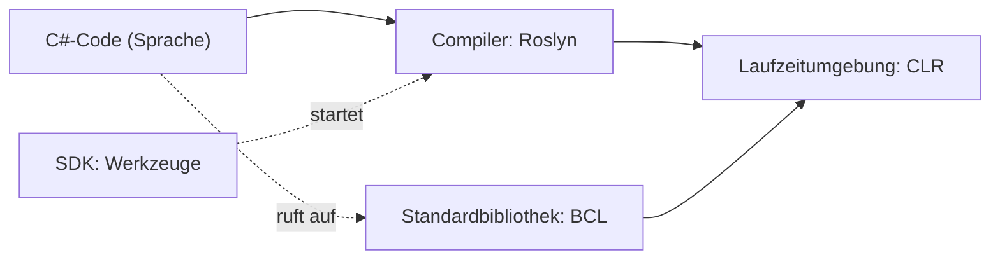

import CodeBlock from '@theme/CodeBlock';
import aliasTypes from '!!raw-loader!@site/examples/m00/l02/alias-types.cs';
import aliasTypesOutput from '!!raw-loader!@site/examples/m00/l02/alias-types.out.txt';
import seclogLine from '!!raw-loader!@site/examples/m00/l02/seclog-line.cs';
import seclogLineOutput from '!!raw-loader!@site/examples/m00/l02/seclog-line.out.txt';
import projectTask from '!!raw-loader!@site/examples/m00/l02/seclog-profile-task.cs';
import projectTests from '!!raw-loader!@site/examples/m00/l02/seclog-profile-task.tests.snippet.cs';
import projectSolution from '!!raw-loader!@site/examples/m00/l02/seclog-profile-solution.cs';

# C# und .NET: Sprache und Plattform

:::note[Lernziele]
- Du ordnest Begriffe richtig zu: Sprache (C#), Laufzeitumgebung (CLR), Standardbibliothek (BCL), SDK, Compiler (Roslyn).
- Du erkennst in einem Programm, was zur Sprache gehört (Schlüsselwörter wie `var`, `int`) und was aus der Bibliothek kommt (`Console`, `Math`).
- Du erklärst, warum es drei Quellen gibt (Standard, Entwurf auf Microsoft Learn, Feature-Spezifikationen) und welche du für welche Frage liest.
:::

## Rückblick

<Quiz id="m00-l01-q3" />

<Quiz id="m00-l01-q4" />

## Sprache und Plattform sind zwei Dinge

In der ersten Lektion hast du `Console.WriteLine("Hello");` geschrieben. Dahinter stecken mehrere Teile, die oft in einen Topf geworfen werden. Diese Lektion trennt sie.

<Term id="csharp">C#</Term> ist eine **Sprache**: Sie legt fest, wie du Code schreibst und was er bedeutet. Das steht in der <Term id="language-specification">Sprachspezifikation</Term>. Sie beschreibt, wie C#-Programme aussehen und was sie bedeuten. Sie beschreibt nicht, wie ein Programm für einen Computer übersetzt oder gestartet wird.

<Term id="dotnet">.NET</Term> ist die **Plattform**, die C#-Programme ausführt. Zu .NET gehören diese Komponenten:

| Teil | Aufgabe |
| --- | --- |
| Runtime (<Term id="clr">CLR</Term>, Laufzeitumgebung) | führt den übersetzten Code aus |
| Libraries (<Term id="bcl">BCL</Term>, Standardbibliothek) | fertige Typen und Methoden, zum Beispiel für JSON |
| Compiler (<Term id="roslyn">Roslyn</Term> für C#) | übersetzt Quelltext in ausführbaren Code |
| <Term id="sdk">SDK</Term> und Werkzeuge | bauen, testen und starten Projekte, zum Beispiel mit `dotnet build` |

<Diagram
  caption="Von der Sprache zum laufenden Programm"
  description="Du schreibst C#-Code. Der Compiler Roslyn übersetzt ihn. Die Laufzeitumgebung CLR führt das Ergebnis aus. Dein Code ruft dabei Typen der Standardbibliothek BCL auf, zum Beispiel Console. Das SDK enthält die Werkzeuge, die diese Schritte für ein Projekt auslösen. Der Begriff C# gehört nur zum ersten Kasten, alle anderen gehören zu .NET."
>

</Diagram>

Wie aus dem Code ein laufendes Programm wird, erfährst du in Lektion 5. Hier genügt: Der Compiler wird nur genannt.

## Sprache oder Bibliothek?

Die Spezifikation schreibt vor, dass jede Implementierung von C# eine kleine Standardbibliothek mitbringt. Sie enthält nur Typen, die die Sprache selbst braucht. Von einer Implementierung wird erwartet, dass sie eine viel größere Bibliothek mitliefert. Die Typen, die du täglich benutzt, stammen aus dieser größeren Bibliothek von .NET.

Ein Beispiel für die Grenze: Das Schlüsselwort `int` gehört zur Sprache. Die Spezifikation legt fest, dass solche einfachen Typen Aliase (andere Namen) für Typen im Namespace `System` sind. `typeof(int).FullName` fragt nach dem vollen Namen dieses Bibliothekstyps.

:::info[Vorhersage]
Was geben die drei Zeilen aus? Schreibe deinen Tipp für jede Zeile auf und führe den Code dann aus.
:::

<CSharpRunner id="m00-l02-alias" code={aliasTypes} predict expected={aliasTypesOutput} />

Lösung und Erklärung anzeigen

Die Ausgabe ist `System.Int32`, `System.String` und `System.Boolean`.

1. **Schlüsselwort lesen:** `int`, `string` und `bool` sind Schlüsselwörter der Sprache.
2. **Alias auflösen:** Jedes Schlüsselwort steht für einen Typ der Bibliothek im Namespace `System`.
3. **Namen ablesen:** `FullName` gibt den vollen Namen dieses Typs aus.

Was passiert, wenn du `typeof(double)` einsetzt? Probiere es im Runner aus.

Vertiefung: Warum gibt es Aliase? (optional)

Die Spezifikation definiert die einfachen Typen als Aliase für Strukturtypen im Namespace `System` und enthält eine Tabelle der Zuordnungen (siehe [§8 Types](https://learn.microsoft.com/dotnet/csharp/language-reference/language-specification/types)). Die Pflicht-Bibliothek steht in [Annex C: Standard library](https://learn.microsoft.com/dotnet/csharp/language-reference/language-specification/standard-library). Du kannst also `int` oder `System.Int32` schreiben. Beides meint denselben Typ.

## Ein Programm zerlegen

:::info[Vorhersage]
Was gibt das folgende Programm aus? Überlege dabei, welche Wörter zur Sprache und welche zur Bibliothek gehören. Die Kommentare im Code verraten die Antwort. Lies sie erst nach deinem Tipp.
:::

<CSharpRunner id="m00-l02-seclog-line" code={seclogLine} predict expected={seclogLineOutput} />

Lösung und Erklärung anzeigen

Die Ausgabe ist `LOGIN FAILED USER=ALICE` und `5`.

1. **Sprache erkennen:** `var`, `int`, `=` und `;` sind Teil der Sprache.
2. **Bibliothek erkennen:** `Console`, `Math` und `ToUpper` sind Typen oder Methoden der Bibliothek.
3. **Ausgabe ablesen:** `ToUpper` macht aus dem Text Großbuchstaben. `Math.Max` gibt die größere der beiden Zahlen zurück, hier `5`.

Was passiert, wenn du `Math.Max(attempts, 1)` schreibst? Probiere es im Runner aus.

## Projektschritt

**Stand bisher:** SecLog gibt Titel und Zweck aus.

**Neue Anforderung:** Der Steckbrief soll die Sprache und die Plattform nennen: `Language: C#` und `Platform: .NET`. Hänge die zwei Zeilen unter die vorhandenen. Die Sprache und die Plattform sind zwei verschiedene Dinge, darum bekommt jedes eine eigene Zeile.

<CSharpRunner id="m00-l02-project" code={projectTask} tests={projectTests} />

Musterlösung anzeigen

<CodeBlock language="csharp" title="seclog-profile-solution.cs">{projectSolution}</CodeBlock>

1. **Trennen:** C# ist die Sprache, .NET ist die Plattform.
2. **Zeilen schreiben:** Zwei neue `Console.WriteLine`-Anweisungen mit je einem Text in Anführungszeichen.
3. **Reihenfolge prüfen:** Die neuen Zeilen stehen unter den alten, denn die Anweisungen laufen von oben nach unten.

**Neuer Stand:** Der Steckbrief nennt Titel, Zweck, Sprache und Plattform.

## Drei Quellen für „die Spezifikation“

Wenn du genau wissen willst, was in C# erlaubt ist, gibt es drei Schichten:

1. **ECMA-334:** der veröffentlichte Standard. Die neueste Ausgabe auf der Ecma-Seite ist die 7. Ausgabe (Dezember 2023); Ecma ordnet sie C# 7 zu ([ECMA-334](https://ecma-international.org/publications-and-standards/standards/ecma-334)). *Stand: 2026-10-25.*
2. **Entwurf des Standards auf Microsoft Learn:** der Arbeitstext der nächsten Ausgabe. Er enthält schon spätere Features.
3. **Feature-Spezifikationen:** Der Standard liegt hinter der Implementierung zurück. Darum gibt es für neuere Features eigene Spezifikationen, bis der Standard sie aufnimmt.

Faustregel: Frage zuerst den Entwurf auf Microsoft Learn. Steht das Feature dort nicht, lies die Feature-Spezifikation. Für Fragen zu `Console`, `List<T>` oder anderen Bibliothekstypen hilft die Spezifikation nicht, dafür gibt es die Dokumentation der Bibliothek auf Microsoft Learn.

## Typische Fehlvorstellungen

:::warning[Achtung]
<Misconception id="m00-l02-csharp-is-dotnet" />

**„C# und .NET sind dasselbe.“** C# ist die Sprache. .NET ist die Plattform mit Laufzeitumgebung, Bibliothek, Compiler und SDK. .NET kann auch Programme in anderen Sprachen ausführen. C# ist davon die beliebteste.
:::

:::warning[Achtung]
<Misconception id="m00-l02-console-is-language" />

**„`Console.WriteLine` gehört zur Sprache C#.“** `Console` ist ein Typ der Bibliothek, `WriteLine` eine seiner Methoden. Die Sprache legt fest, wie ein Aufruf aussieht. Was `WriteLine` tut, steht in der Dokumentation der Bibliothek.
:::

## Zusammenfassung

C# ist eine Sprache. Ihre Regeln stehen in der Spezifikation, die nur die Sprache beschreibt. .NET ist die Plattform mit Compiler (Roslyn), Laufzeitumgebung (CLR), Standardbibliothek (BCL) und SDK. Schlüsselwörter wie `var` und `int` gehören zur Sprache, `Console` und `Math` zur Bibliothek. Für Sprachfragen gibt es drei Quellen: den ECMA-Standard, den Entwurf auf Microsoft Learn und die Feature-Spezifikationen.

## Prüfe dein Wissen

<Quiz id="m00-l02-q1" />

<Quiz id="m00-l02-q2" />

<Quiz id="m00-l02-q3" />

<Quiz id="m00-l02-q4" />

<Quiz id="m00-l02-q5" />

### In eigenen Worten erklären

<Quiz id="m00-l02-q6" />

### Transferfrage

<Quiz id="m00-l02-q7" />

## Weiterlesen

- Microsoft Learn: [Introduction to .NET](https://learn.microsoft.com/dotnet/core/introduction)
- Microsoft Learn: [Common Language Runtime (CLR) overview](https://learn.microsoft.com/dotnet/standard/clr)
- Microsoft Learn: [C#-Spezifikation, Scope](https://learn.microsoft.com/dotnet/csharp/language-reference/language-specification/scope)
