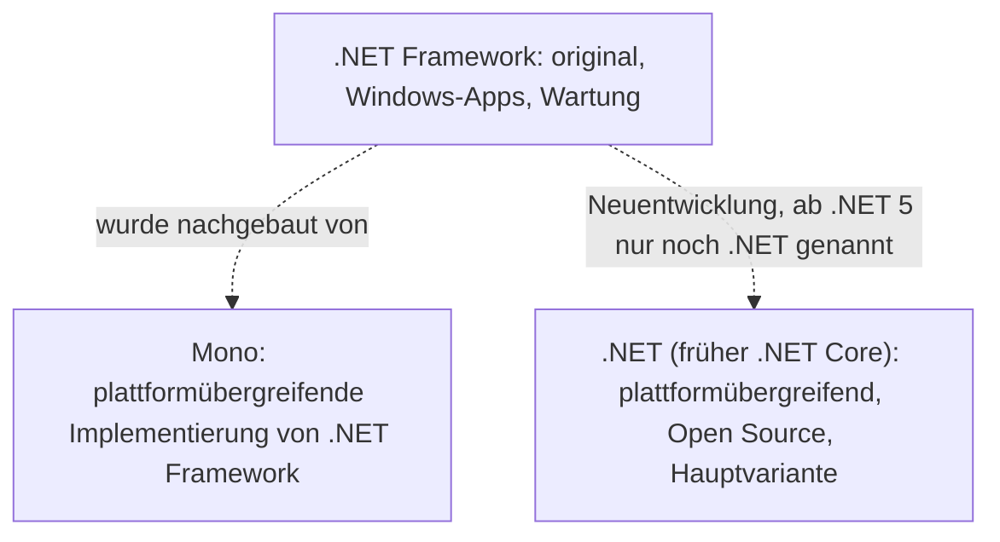

import CodeBlock from '@theme/CodeBlock';
import familyFacts from '!!raw-loader!@site/examples/m00/l03/family-facts.cs';
import familyFactsOutput from '!!raw-loader!@site/examples/m00/l03/family-facts.out.txt';
import choiceTask from '!!raw-loader!@site/examples/m00/l03/seclog-choice-task.cs';
import choiceTests from '!!raw-loader!@site/examples/m00/l03/seclog-choice-task.tests.snippet.cs';
import choiceSolution from '!!raw-loader!@site/examples/m00/l03/seclog-choice-solution.cs';

# Die .NET-Familie

:::note[Lernziele]
- Du unterscheidest .NET Framework, .NET Core und das heutige .NET (ab .NET 5) nach Plattform und Weiterentwicklung.
- Du erkennst falsche Namen und Verwechslungen („.NET Core“ ≠ „Entity Framework Core“; „.NET Framework Core“ gibt es nicht).
- Du entscheidest für ein neues Projekt begründet, welche .NET-Variante du nimmst.
:::

## Rückblick

<Quiz id="m00-l02-q1" />

<Quiz id="m00-l02-q3" />

## Mehrere Varianten von .NET

In Lektion 2 war <Term id="dotnet">.NET</Term> die Plattform, die C#-Programme ausführt. Es gibt sie in mehreren Varianten. Microsoft nennt sie *Implementierungen* und sagt, jede unterstütze „a different type of app for both historical and technical reasons“ ([Introduction to .NET](https://learn.microsoft.com/dotnet/core/introduction)). Drei Namen brauchst du:

| Name | Kurzbeschreibung laut Microsoft Learn |
| --- | --- |
| <Term id="dotnet-framework">.NET Framework</Term> | Die ursprüngliche Variante, seit 2002. Gedacht für Windows-Apps und Webdienste, optimiert für Windows-Desktop-Anwendungen. Sie wird gewartet. |
| <Term id="dotnet-core">.NET (Core)</Term> | Die moderne Variante: plattformübergreifend, Open Source, weiterentwickelt. Früher „.NET Core“ genannt, heute einfach „.NET“. |
| <Term id="mono">Mono</Term> | Eine plattformübergreifende, quelloffene Implementierung von .NET Framework. |

Quellen: [Introduction to .NET](https://learn.microsoft.com/dotnet/core/introduction), [.NET implementations](https://learn.microsoft.com/dotnet/fundamentals/implementations) und [Overview of .NET Framework](https://learn.microsoft.com/dotnet/framework/get-started/overview). *Stand: 2026-10-25.*

Die Umbenennung heißt: Wenn heute jemand „.NET“ sagt, meint er in der Regel die moderne Variante, die ab .NET 5 so heißt. Microsoft schreibt: „.NET, previously referred to as .NET Core, is currently the primary implementation.“ ([.NET implementations](https://learn.microsoft.com/dotnet/fundamentals/implementations)). Für neue Projekte rät Microsoft: „for new development, use .NET instead of .NET Framework“ ([Overview of .NET Framework](https://learn.microsoft.com/dotnet/framework/get-started/overview)). Bestehende .NET-Framework-Apps musst du laut derselben Seite nicht migrieren.

<Diagram
  caption="Die .NET-Familie im Überblick"
  description="Drei Implementierungen von .NET. Das .NET Framework ist die ursprüngliche Variante für Windows-Apps und wird gewartet. Mono ist eine plattformübergreifende Implementierung von .NET Framework. Das moderne .NET, früher .NET Core genannt, ist plattformübergreifend, quelloffen und die Hauptvariante für neue Projekte."
>

</Diagram>

## Zwei Namen, die oft verwechselt werden

„.NET Core“ und <Term id="ef-core">Entity Framework Core</Term> (EF Core) klingen ähnlich, sind aber verschiedene Dinge. EF Core greift auf Datenbanken zu und ist laut Microsoft „a lightweight, extensible, open source and cross-platform version of the popular Entity Framework data access technology“ ([EF Core](https://learn.microsoft.com/ef/core/)). .NET Core ist die Plattform. EF Core ist eine Bibliothek, die darauf läuft. Ein „.NET Framework Core“ gibt es nicht.

## .NET Standard und Mono in je einem Absatz

<Term id="dotnet-standard">.NET Standard</Term> ist „a formal specification of .NET APIs that are available on multiple .NET implementations“. Es sollte Bibliotheken ermöglichen, die auf mehreren Varianten laufen. .NET 5 und neuer brauchen es in den meisten Fällen nicht mehr. Neue Versionen erscheinen nicht mehr ([.NET Standard overview](https://learn.microsoft.com/dotnet/standard/net-standard)). Du brauchst es als Anfänger nur zu erkennen, wenn du es in fremden Projekten siehst.

Mono begann als Community-Projekt. Es war laut Microsoft die Laufzeit, die Xamarin-Apps (inzwischen nicht mehr unterstützt) antrieb, und es dient auch Spielen mit der Unity-Engine ([.NET implementations](https://learn.microsoft.com/dotnet/fundamentals/implementations)). In diesem Kurs spielt Mono keine Rolle.

Technik, die es nur im .NET Framework gab (zum Beispiel AppDomains, Remoting, WCF-Server), behandelt der Kurs nicht. Sie gehört zur Geschichte.

## Vorhersage und Lauf

:::info[Vorhersage]
Was gibt das Programm aus? Achte auf `Console.Write` und `Console.WriteLine` und auf die leere Zeile. Schreibe deinen Tipp für jede Zeile auf und führe den Code dann aus.
:::

<CSharpRunner id="m00-l03-family" height={360} code={familyFacts} predict expected={familyFactsOutput} />

Lösung und Erklärung anzeigen

Die Ausgabe sind fünf Zeilen, die vierte ist leer.

1. **Zeilen zusammensetzen:** `Write` bleibt in der Zeile, erst `WriteLine` beendet sie. Darum stehen Name und Pfeiltext zusammen.
2. **Leere Zeile erkennen:** `Console.WriteLine();` ohne Argument gibt nur einen Zeilenumbruch aus.
3. **Mono-Zeile lesen:** Drei Aufrufe ergeben eine Zeile, weil nur der letzte `WriteLine` ist.

Was passiert, wenn du das erste `Write` durch `WriteLine` ersetzt? Probiere es im Runner aus.

## Ändern und selbermachen

Das SecLog-Werkzeug soll auf einem Linux-Server und auf Windows-Laptops laufen. Im Startcode steht eine Wahl, die dazu nicht passt.

<CSharpRunner id="m00-l03-choice" height={320} code={choiceTask} tests={choiceTests} />

Aufgabe: Ändere nur die dritte Zeile so, dass sie `Choice: .NET 10` ausgibt. Begründung: .NET Framework ist eine Windows-Technologie, das heutige .NET ist plattformübergreifend ([Introduction to .NET](https://learn.microsoft.com/dotnet/core/introduction)).

Musterlösung anzeigen

<CodeBlock language="csharp" title="seclog-choice-solution.cs">{choiceSolution}</CodeBlock>

Die Entscheidung folgt aus zwei Schritten: Erst die Anforderung (Linux und Windows), dann die Variante, die beides abdeckt (das heutige .NET).

## Typische Fehlvorstellungen

:::warning[Achtung]
<Misconception id="m00-l03-dotnet-core-is-ef-core" />

**„.NET Core und Entity Framework Core sind dasselbe.“** .NET Core ist die Plattform, EF Core eine Bibliothek für Datenbanken, die auf .NET läuft. Das „Core“ im Namen ist Zufall der Namensgebung.
:::

:::warning[Achtung]
<Misconception id="m00-l03-framework-is-current" />

**„.NET Framework ist die aktuelle Version für neue Projekte.“** Das .NET Framework wird gewartet, aber für Neuentwicklung empfiehlt Microsoft das heutige .NET ([Overview of .NET Framework](https://learn.microsoft.com/dotnet/framework/get-started/overview)).
:::

## Kommst du aus …?

<FromLanguage>
<TabItem value="java">

Java hat auch mehrere Varianten (zum Beispiel Java SE und Android), aber eine gemeinsame Sprache. Bei .NET gleicht die Lage dem Wechsel von einer alten zu einer neuen Plattform: Das .NET Framework ist die alte, das heutige .NET die neue.

</TabItem>
<TabItem value="python">

Der Wechsel von Python 2 zu Python 3 ist ein ähnliches Bild: Die alte Variante bleibt in Betrieb, neue Projekte nutzen die neue.

</TabItem>
<TabItem value="js">

Wie bei Node.js ist die moderne Variante plattformübergreifend und Open Source. Das .NET Framework entspricht eher einer alten, an Windows gebundenen Laufzeit.

</TabItem>
<TabItem value="go">

Go hat eine einzige Implementierung als Standard. Bei .NET musst du beim Lesen von Tutorials darauf achten, welche Variante gemeint ist.

</TabItem>
</FromLanguage>

## Zusammenfassung

Es gibt drei Namen: .NET Framework (ursprünglich, für Windows, gewartet), .NET Core (plattformübergreifend, Open Source) und ab .NET 5 einfach .NET. Mono ist eine Implementierung von .NET Framework, .NET Standard eine inzwischen abgeschlossene Spezifikation für gemeinsame Bibliotheken. EF Core ist eine Datenbankbibliothek und nicht die Plattform. Für neue Projekte empfiehlt Microsoft das heutige .NET.

## Prüfe dein Wissen

<Quiz id="m00-l03-q1" />

<Quiz id="m00-l03-q2" />

<Quiz id="m00-l03-q3" />

<Quiz id="m00-l03-q4" />

<Quiz id="m00-l03-q5" />

### In eigenen Worten erklären

<Quiz id="m00-l03-q6" />

### Transferfrage

<Quiz id="m00-l03-q7" />

## Weiterlesen

- Microsoft Learn: [.NET implementations](https://learn.microsoft.com/dotnet/fundamentals/implementations)
- Microsoft Learn: [Introduction to .NET](https://learn.microsoft.com/dotnet/core/introduction)
- Microsoft Learn: [.NET Standard overview](https://learn.microsoft.com/dotnet/standard/net-standard)
