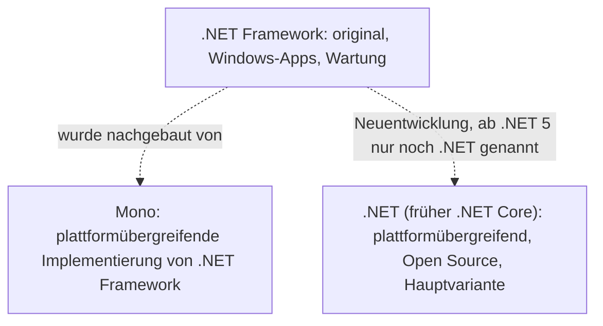

import CodeBlock from '@theme/CodeBlock';
import familyFacts from '!!raw-loader!@site/examples/m00/l03/family-facts.cs';
import familyFactsOutput from '!!raw-loader!@site/examples/m00/l03/family-facts.out.txt';
import projectTask from '!!raw-loader!@site/examples/m00/l03/seclog-profile-task.cs';
import projectTests from '!!raw-loader!@site/examples/m00/l03/seclog-profile-task.tests.snippet.cs';
import projectSolution from '!!raw-loader!@site/examples/m00/l03/seclog-profile-solution.cs';

# Die .NET-Familie

:::note[Lernziele]
- Du unterscheidest .NET Framework, .NET Core und das heutige .NET (ab .NET 5) nach Plattform und Weiterentwicklung.
- Du erkennst falsche Namen und Verwechslungen („.NET Core“ ≠ „Entity Framework Core“; „.NET Framework Core“ gibt es nicht).
- Du entscheidest für ein neues Projekt begründet, welche .NET-Variante du nimmst.
:::

## Rückblick

<Quiz id="m00-l02-q1" />

<Quiz id="m00-l02-q3" />

## Mehrere Varianten von .NET

In Lektion 2 war <Term id="dotnet">.NET</Term> die Plattform, die C#-Programme ausführt. Es gibt sie in mehreren Varianten, die *Implementierungen* heißen. Jede Implementierung ist aus historischen und technischen Gründen für andere Arten von Apps gedacht. Drei Namen brauchst du:

| Name | Kurzbeschreibung |
| --- | --- |
| <Term id="dotnet-framework">.NET Framework</Term> | Die ursprüngliche Variante, seit 2002. Gedacht für Windows-Apps und Webdienste, optimiert für Windows-Desktop-Anwendungen. Sie wird gewartet. |
| <Term id="dotnet-core">.NET (Core)</Term> | Die moderne Variante: plattformübergreifend, Open Source, weiterentwickelt. Früher „.NET Core“ genannt, heute einfach „.NET“. |
| <Term id="mono">Mono</Term> | Eine plattformübergreifende, quelloffene Implementierung von .NET Framework. |

Die Umbenennung heißt: Wenn heute jemand „.NET“ sagt, meint er in der Regel die moderne Variante, die ab .NET 5 so heißt. Das heutige .NET, früher .NET Core genannt, ist derzeit die primäre Implementierung ([.NET implementations](https://learn.microsoft.com/dotnet/fundamentals/implementations), Stand: 2026-10-28). Für neue Projekte nimmst du .NET statt .NET Framework. Bestehende .NET-Framework-Apps musst du nicht migrieren.

<Diagram
  caption="Die .NET-Familie im Überblick"
  description="Drei Implementierungen von .NET. Das .NET Framework ist die ursprüngliche Variante für Windows-Apps und wird gewartet. Mono ist eine plattformübergreifende Implementierung von .NET Framework. Das moderne .NET, früher .NET Core genannt, ist plattformübergreifend, quelloffen und die Hauptvariante für neue Projekte."
>

</Diagram>

## Zwei Namen, die oft verwechselt werden

„.NET Core“ und <Term id="ef-core">Entity Framework Core</Term> (EF Core) klingen ähnlich, sind aber verschiedene Dinge. EF Core greift auf Datenbanken zu und ist eine leichtgewichtige, erweiterbare, quelloffene und plattformübergreifende Version der Datenzugriffstechnologie Entity Framework. .NET Core ist die Plattform. EF Core ist eine Bibliothek, die darauf läuft. Ein „.NET Framework Core“ gibt es nicht.

## .NET Standard und Mono in je einem Absatz

<Term id="dotnet-standard">.NET Standard</Term> ist eine formale Spezifikation von .NET-Schnittstellen (APIs), die auf mehreren Implementierungen vorhanden sind. Es sollte Bibliotheken ermöglichen, die auf mehreren Varianten laufen. .NET 5 und neuer brauchen es in den meisten Fällen nicht mehr. Neue Versionen erscheinen nicht mehr (Stand: 2026-10-28, siehe [.NET Standard overview](https://learn.microsoft.com/dotnet/standard/net-standard)). Du brauchst es als Anfänger nur zu erkennen, wenn du es in fremden Projekten siehst.

Mono begann als Community-Projekt. Es war die Laufzeit, die Xamarin-Apps antrieb (Xamarin wird nicht mehr unterstützt), und es treibt auch Spiele mit der Unity-Engine an. In diesem Kurs spielt Mono keine Rolle.

Technik, die es nur im .NET Framework gab (zum Beispiel AppDomains, Remoting, WCF-Server), behandelt der Kurs nicht. Sie gehört zur Geschichte.

## Vorhersage und Lauf

:::info[Vorhersage]
Was gibt das Programm aus? Achte auf `Console.Write` und `Console.WriteLine` und auf die leere Zeile. Schreibe deinen Tipp für jede Zeile auf und führe den Code dann aus.
:::

<CSharpRunner id="m00-l03-family" code={familyFacts} predict expected={familyFactsOutput} />

Lösung und Erklärung anzeigen

Die Ausgabe sind fünf Zeilen, die vierte ist leer.

1. **Zeilen zusammensetzen:** `Write` bleibt in der Zeile, erst `WriteLine` beendet sie. Darum stehen Name und Pfeiltext zusammen.
2. **Leere Zeile erkennen:** `Console.WriteLine();` ohne Argument gibt nur einen Zeilenumbruch aus.
3. **Mono-Zeile lesen:** Drei Aufrufe ergeben eine Zeile, weil nur der letzte `WriteLine` ist.

Was passiert, wenn du das erste `Write` durch `WriteLine` ersetzt? Probiere es im Runner aus.

## Projektschritt

**Stand bisher:** Der Steckbrief nennt Titel, Zweck, Sprache und Plattform.

**Neue Anforderung:** SecLog soll auf einem Linux-Server und auf Windows-Laptops laufen. Ergänze eine Zeile, die die passende .NET-Variante nennt: `Variant: .NET (Linux server and Windows laptops)`.

<CSharpRunner id="m00-l03-project" code={projectTask} tests={projectTests} />

Musterlösung anzeigen

<CodeBlock language="csharp" title="seclog-profile-solution.cs">{projectSolution}</CodeBlock>

1. **Anforderung klären:** SecLog muss auf Linux und auf Windows laufen.
2. **Variante wählen:** Das .NET Framework ist eine Windows-Technologie. Das heutige .NET ist plattformübergreifend und deckt beides ab.
3. **Zeile ergänzen:** Eine neue `Console.WriteLine`-Anweisung unter den vorhandenen.

**Neuer Stand:** Der Steckbrief nennt zusätzlich die .NET-Variante.

## Typische Fehlvorstellungen

:::warning[Achtung]
<Misconception id="m00-l03-dotnet-core-is-ef-core" />

**„.NET Core und Entity Framework Core sind dasselbe.“** .NET Core ist die Plattform, EF Core eine Bibliothek für Datenbanken, die auf .NET läuft. Das „Core“ im Namen ist Zufall der Namensgebung.
:::

:::warning[Achtung]
<Misconception id="m00-l03-framework-is-current" />

**„.NET Framework ist die aktuelle Version für neue Projekte.“** Das .NET Framework wird gewartet, aber für Neuentwicklung nimmst du das heutige .NET.
:::

## Zusammenfassung

Es gibt drei Namen: .NET Framework (ursprünglich, für Windows, gewartet), .NET Core (plattformübergreifend, Open Source) und ab .NET 5 einfach .NET. Mono ist eine Implementierung von .NET Framework, .NET Standard eine inzwischen abgeschlossene Spezifikation für gemeinsame Bibliotheken. EF Core ist eine Datenbankbibliothek und nicht die Plattform. Für neue Projekte nimmst du das heutige .NET.

## Prüfe dein Wissen

<Quiz id="m00-l03-q1" />

<Quiz id="m00-l03-q2" />

<Quiz id="m00-l03-q3" />

<Quiz id="m00-l03-q4" />

<Quiz id="m00-l03-q5" />

### In eigenen Worten erklären

<Quiz id="m00-l03-q6" />

### Transferfrage

<Quiz id="m00-l03-q7" />

## Weiterlesen

- Microsoft Learn: [.NET implementations](https://learn.microsoft.com/dotnet/fundamentals/implementations)
- Microsoft Learn: [Introduction to .NET](https://learn.microsoft.com/dotnet/core/introduction)
- Microsoft Learn: [.NET Standard overview](https://learn.microsoft.com/dotnet/standard/net-standard)
