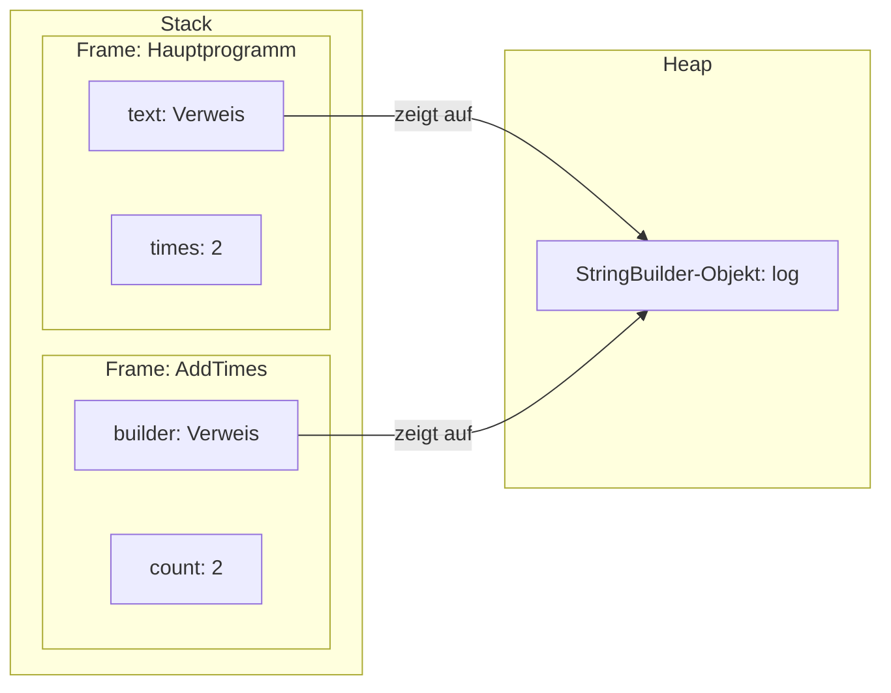

import stackHeapModel from '!!raw-loader!@site/examples/m04/l02/stack-heap-model.cs';

# Stack und Heap – ein Modell

:::note[Lernziele]
- Du kannst mit dem Stack-Heap-Modell beschreiben, wo die Werte eines kleinen Programms liegen könnten.
- Du kannst erklären, warum das Modell eine Eigenschaft der Laufzeitumgebung beschreibt und keine Regel der Sprache ist.
- Du kannst erklären, was automatische Speicherverwaltung für dich als Programmierer bedeutet.
:::

## Rückblick

<Quiz id="m04-l01-q3" />

<Quiz id="m04-l01-q6" />

<Quiz id="m03-l10-q2" />

## Ein Modell für den Speicher

In der letzten Lektion ging es darum, was eine Variable enthält: einen Wert oder einen Verweis auf ein Objekt. Offen blieb, wo das Objekt liegt. Dafür gibt es ein einfaches Bild, das <Term id="stack">Stack (Stapelspeicher)</Term> und <Term id="heap">Heap (Halde)</Term> nutzt:

- Jeder laufende Methodenaufruf hat einen Frame (Rahmen) auf dem Stack, wie auf dem <Term id="call-stack">Aufrufstapel</Term> aus Modul 3. Der Frame enthält die Parameter und lokalen Variablen des Aufrufs.
- Die Objekte der Referenztypen liegen auf dem Heap. Die Variable im Frame enthält den Verweis darauf.

Das ist ein **Modell**: ein Bild, das hilft, Programme zu verstehen. Es beschreibt eine Laufzeitumgebung, nicht die Sprache C#.

<Diagram
  caption="Stack-Heap-Modell für AddTimes(text, times)"
  description="Links der Stack mit zwei Frames. Der untere Frame gehört zum Hauptprogramm und enthält die Variable text mit einem Verweis und die Variable times mit dem Wert 2. Der obere Frame gehört zum Aufruf AddTimes und enthält den Parameter builder mit einem Verweis und den Parameter count mit dem Wert 2. Rechts der Heap mit einem StringBuilder-Objekt mit dem Text log. Beide Verweise, der von text und der von builder, zeigen auf dasselbe Objekt."
>

</Diagram>

:::info[Vorhersage]
Das Programm ruft `AddTimes(text, times)` auf. Wie viele Objekte gibt es im Modell, und was zeigt die letzte Ausgabezeile? Starte dann den Runner und gehe die Schritte durch.
:::

<CSharpRunner id="m04-l02-model" code={stackHeapModel} trace />

Lösung und Erklärung anzeigen

Es gibt ein Objekt, die Ausgabe ist `log2`.

1. **Frame des Hauptprogramms:** `text` enthält einen Verweis auf das `StringBuilder`-Objekt, `times` enthält die `2`.
2. **Frame des Aufrufs:** `builder` bekommt eine Kopie des Verweises, `count` eine Kopie der `2`. Beide Verweise zeigen auf dasselbe Objekt.
3. **Objekt ändern:** `builder.Append(count)` hängt `2` an das eine Objekt.
4. **Frame abräumen:** Nach dem Aufruf verschwindet der Frame. Das Objekt bleibt, weil `text` noch darauf zeigt.

**Was passiert, wenn du in `AddTimes` zusätzlich `count = 5;` schreibst?** Dann ändert sich nur `count` im Frame des Aufrufs. `times` bleibt `2`, und die Ausgabe bleibt `log2`.

## Was die Sprache verspricht

C# verlangt eine <Term id="automatic-memory-management">automatische Speicherverwaltung</Term>: Du musst Speicher für Objekte nicht selbst anfordern und freigeben. Das übernimmt der <Term id="garbage-collector">Garbage Collector (Speicherbereinigung)</Term>. Er gibt den Speicher eines Objekts frei, wenn das Programm das Objekt nicht mehr erreichen kann. Zu welchem Zeitpunkt das geschieht, legt die Sprache nicht fest. Wo ein Wert im Speicher liegt, legt sie ebenfalls nicht fest.

Für dich heißt das: Du schreibst `new`, und die Laufzeitumgebung kümmert sich um den Rest. Du musst nur wissen, ob eine Variable einen Wert oder einen Verweis enthält, denn das entscheidet, was eine Zuweisung kopiert.

:::warning[Achtung]
<Misconception id="m04-l02-value-types-on-stack" />

**„Werttypen liegen immer auf dem Stack.“** Das ist keine Regel der Sprache. Die Sprache nennt für Werte keinen Ort, sie verlangt nur automatische Speicherverwaltung. Das Stack-Heap-Modell ist ein Bild für eine Laufzeitumgebung. Merke dir die Regel, die wirklich gilt: Ein Werttyp enthält den Wert in der Variablen, ein Referenztyp enthält einen Verweis.
:::

## Lückenbeispiel

Beschreibe das Programm mit eigenen Worten im Modell. Das Programm erzeugt `var report = new StringBuilder("bob");` im Hauptprogramm und übergibt `report` an eine Methode. Ergänze in Gedanken die drei Angaben:

1. Im Frame des Hauptprogramms steht `report` mit einem ___.
2. Das `StringBuilder`-Objekt liegt auf dem ___.
3. Der Parameter der Methode im neuen Frame enthält eine ___ des Verweises.

Lösung anzeigen

1. **Verweis**
2. **Heap**
3. **Kopie**

## Projektschritt

In dieser Lektion kommt kein Projektschritt dazu, weil das Stack-Heap-Modell nur beschreibt, wo Werte liegen könnten, und den Code von SecLog nicht ändert.

Vertiefung: Automatische Speicherverwaltung in der Spezifikation (optional)

Der Garbage Collector entscheidet, wo ein neues Objekt liegt, wann er es verschiebt und wann es nicht mehr gebraucht wird. Die Sprache lässt ihm dabei viel Spielraum und nennt weder eine Zeit noch eine Reihenfolge ([§7.8 Automatic memory management](https://learn.microsoft.com/dotnet/csharp/language-reference/language-specification/basic-concepts#78-automatic-memory-management)).

Wie die .NET-Laufzeitumgebung den Speicher einteilt, kannst du im Artikel zur Speicherbereinigung nachlesen. Die Einzelheiten gehören nicht zu diesem Kurs.

## Zusammenfassung

Das Stack-Heap-Modell ist ein Bild: Jeder Aufruf hat einen Frame auf dem Stack, die Objekte der Referenztypen liegen auf dem Heap, und die Variablen halten Verweise darauf. Es beschreibt eine Laufzeitumgebung und ist keine Regel der Sprache. Die Sprache verlangt automatische Speicherverwaltung. Du gibst Objekte nicht selbst frei, das macht der Garbage Collector.

## Prüfe dein Wissen

<Quiz id="m04-l02-q1" />

<Quiz id="m04-l02-q2" />

<Quiz id="m04-l02-q3" />

<Quiz id="m04-l02-q4" />

<Quiz id="m04-l02-q5" />

<Quiz id="m04-l02-q6" />

### In eigenen Worten erklären

<Quiz id="m04-l02-q7" />

### Transferfrage

<Quiz id="m04-l02-q8" />

## Weiterlesen

- Microsoft Learn: [Grundlagen der Speicherbereinigung](https://learn.microsoft.com/dotnet/standard/garbage-collection/fundamentals)
- C#-Spezifikation: [§7.8 Automatic memory management](https://learn.microsoft.com/dotnet/csharp/language-reference/language-specification/basic-concepts#78-automatic-memory-management)
