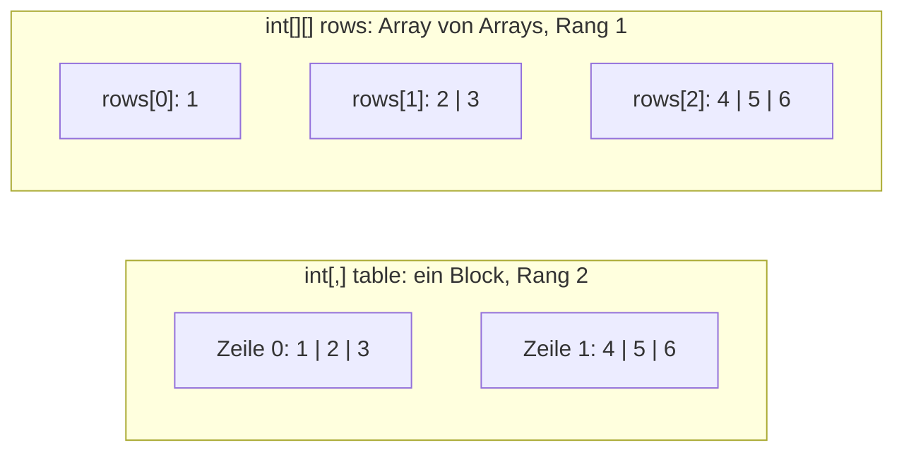

import rectangle from '!!raw-loader!@site/examples/m05/l02/rectangle.cs';
import rectangleOutput from '!!raw-loader!@site/examples/m05/l02/rectangle.out.txt';
import jagged from '!!raw-loader!@site/examples/m05/l02/jagged.cs';
import sumTable from '!!raw-loader!@site/examples/m05/l02/sum-table.cs';
import projectTask from '!!raw-loader!@site/examples/m05/l02/seclog-collections-task.cs';
import projectInput from '!!raw-loader!@site/examples/m05/l02/seclog-collections-solution.in.txt';
import projectTests from '!!raw-loader!@site/examples/m05/l02/seclog-collections-task.tests.snippet.cs';
import projectSolution from '!!raw-loader!@site/examples/m05/l02/seclog-collections-solution.cs';

# Mehrdimensionale und verzweigte Arrays

:::note[Lernziele]
- Du kannst ein zweidimensionales Array anlegen und mit zwei verschachtelten Schleifen durchlaufen.
- Du kannst `int[,]` und `int[][]` unterscheiden und erklären, wann Zeilen verschieden lang sein können.
- Du kannst mit `GetLength` die Größe einer Dimension bestimmen.
:::

## Rückblick

<Quiz id="m02-l09-q2" />

<Quiz id="m05-l01-q3" />

<Quiz id="m05-l01-q4" />

## Eine Tabelle in einem Array

Manche Daten sind eine Tabelle: Zeilen und Spalten, zum Beispiel Fehlversuche pro Benutzer und Stunde. Ein Array kann dafür mehr als einen Index haben. Die Anzahl der Indizes heißt <Term id="rank">Rang (Rank)</Term>. `int[]` hat den Rang 1. Ein Array mit Rang größer als 1 ist ein <Term id="multi-dimensional-array">mehrdimensionales Array</Term>.

`int[,]` hat den Rang 2: ein einziger rechteckiger Block, in dem alle Zeilen gleich lang sind. Ein Komma in den Klammern steht für eine weitere Dimension. Du greifst mit `table[zeile, spalte]` zu, beide Indizes beginnen bei `0`.

Die Größe einer Dimension liefert `GetLength(dimension)`: `GetLength(0)` ist die Anzahl der Zeilen, `GetLength(1)` die der Spalten. `Rank` liefert den Rang. `Length` zählt alle Elemente zusammen, also Zeilen mal Spalten.

:::info[Vorhersage]
`table` hat zwei Zeilen mit je drei Werten. Was gibt das Programm aus?
:::

<CSharpRunner id="m05-l02-rectangle" code={rectangle} predict expected={rectangleOutput} />

Lösung und Erklärung anzeigen

Die Ausgabe ist `4`, `2`, `2`, `3`, `6`.

1. **Zugriff:** `table[1, 0]` ist die zweite Zeile, erste Spalte: `4`.
2. **Rang:** Es gibt zwei Indizes, also ist `Rank` gleich `2`.
3. **Größen:** `GetLength(0)` ist `2` (Zeilen), `GetLength(1)` ist `3` (Spalten).
4. **Alle Elemente:** `Length` ist `2 * 3`, also `6`.

**Was passiert bei `table[2, 0]`?** Es gibt nur die Zeilen 0 und 1. Der Zugriff liegt außerhalb, und das Programm bricht zur Laufzeit ab.

## Zeilen und Spalten durchlaufen

Für eine Tabelle brauchst du zwei verschachtelte Schleifen: die äußere über die Zeilen, die innere über die Spalten. Als Grenzen nimmst du `GetLength(0)` und `GetLength(1)`, nicht feste Zahlen. Dann stimmt der Code auch, wenn sich die Größe der Tabelle ändert.

## Array von Arrays

Bei `int[][]` ist jedes Element selbst ein Array. Man nennt das ein <Term id="jagged-array">verzweigtes Array (Jagged Array)</Term>. Der Rang ist 1: Der äußere Teil ist ein gewöhnliches Array, dessen Elemente `int[]` sind. Darum schreibst du `rows[zeile][spalte]` mit zwei Klammerpaaren, und jede Zeile hat ihre eigene Länge.

Wichtig: `new int[3][]` legt nur das äußere Array mit drei Plätzen an. Die Zeilen sind noch `null`. Jede Zeile musst du selbst mit `new int[…]` anlegen. Auch im Initialisierer steht für jede Zeile ein eigenes `new int[] { … }`.

<CSharpRunner id="m05-l02-jagged" code={jagged} />

Die erste Ausgabe `True` zeigt, dass `rows[0]` zuerst `null` ist. `rows.Rank` ist `1`. Die Zeilen haben 1, 2 und 3 Elemente, und `rows[2][1]` ist `5`. Die letzte Zeile der Ausgabe liest `triangle[2][1]`, die mittlere `2` der dritten Zeile.

<Diagram
  caption="Rechteck und Zeilen"
  description="Links ein rechteckiger Block int[,] mit zwei Zeilen und drei Spalten: alle Zeilen sind gleich lang. Rechts ein Array von Arrays int[][] mit drei Zeilen: die erste Zeile hat ein Element, die zweite zwei und die dritte drei."
>

</Diagram>

:::warning[Achtung]
<Misconception id="m05-l02-jagged-same-as-multidimensional" />

**„`int[][]` und `int[,]` sind dasselbe.“** Das stimmt nicht. `int[,]` ist ein einziges Array mit Rang 2, alle Zeilen sind gleich lang. `int[][]` hat Rang 1, seine Elemente sind Arrays mit jeweils eigener Länge, und jede Zeile muss einzeln angelegt werden.
:::

## Lückenbeispiel

Die Schleifen sollen alle Elemente von `table` summieren. Das Ergebnis soll `21` sein, es kommt aber ein anderer Wert heraus. Ändere die äußere Schleife so, dass sie alle Zeilen durchläuft, und nutze `GetLength(0)`.

<CSharpRunner id="m05-l02-gaps" code={sumTable} />

Lösung anzeigen

1. **Fehler finden:** Die äußere Schleife endet mit `row < 1`. Sie besucht nur die Zeile 0, die Summe ist `6`.
2. **Ersetzen:** `row < table.GetLength(0)` besucht beide Zeilen. Die Summe ist `21`.

## Projektschritt

**Stand bisher:** SecLog hält das Beispiel-Log in `sampleLog`.

Im Runner siehst du nur die Teile, die du für diese Anforderung brauchst: den Block *Hold the whole sample log in an array*. Der übrige Code ist ausgeblendet (Zeilen mit ⋯) und läuft beim Ausführen mit. Lass die Zeilen mit ⋯ stehen.

**Neue Anforderung:** Schreibe nach dem Block *Hold the whole sample log in an array* den Block `// Print a table of failed logins per user and hour`. Lege `string[] users = { "alice", "bob", "carol", "dave" };` an und `int[,] failuresPerHour` mit 4 Zeilen (Benutzer in dieser Reihenfolge) und 2 Spalten (Stunde 8 und Stunde 9). Die Werte sind alice 1/0, bob 5/0, carol 0/0 und dave 0/1. Gib mit zwei verschachtelten `for`-Schleifen und `GetLength(0)` und `GetLength(1)` pro Benutzer eine Zeile aus, zum Beispiel `bob | hour 8: 5 | hour 9: 0`.

Die Werte zählst du hier von Hand aus dem Beispiel-Log ab. SecLog zählt sie in Lektion „Wörterbücher: Dictionary&lt;TKey,TValue&gt;“ selbst aus dem Log.

<CSharpRunner id="m05-l02-project" code={projectTask} stdin={projectInput} tests={projectTests} />

Musterlösung anzeigen

<FoldedCode code={projectSolution} title="seclog-collections-solution.cs" />

1. **Tabelle anlegen:** Der Initialisierer hat vier Zeilen mit je zwei Werten. Die Zeile eines Benutzers hat denselben Index wie der Benutzer in `users`.
2. **Äußere Schleife:** `row` läuft bis `GetLength(0)`, also über die vier Benutzer. Zuerst steht der Name.
3. **Innere Schleife:** `column` läuft bis `GetLength(1)`. Die Stunde ist `8 + column`.

**Neuer Stand:** SecLog gibt eine Tabelle der Fehlversuche pro Benutzer und Stunde aus.

Vertiefung: Rang und Arraytypen in der Spezifikation (optional)

Der Rang eines Arraytyps ergibt sich aus der Zahl der Kommas in den eckigen Klammern plus eins. Ein Array von Arrays ist von einem mehrdimensionalen Array verschieden ([§17.2 Array types](https://learn.microsoft.com/dotnet/csharp/language-reference/language-specification/arrays#172-array-types)). Bei einem mehrdimensionalen Initialisierer müssen alle verschachtelten Initialisierer einer Ebene gleich viele Elemente haben ([§17.7 Array initializers](https://learn.microsoft.com/dotnet/csharp/language-reference/language-specification/arrays#177-array-initializers)). Beim verzweigten Array gilt diese Pflicht nicht, denn jede Zeile ist ein eigener Ausdruck.

## Zusammenfassung

`int[,]` ist ein rechteckiger Block mit Rang 2, den du mit `table[zeile, spalte]` und zwei verschachtelten Schleifen durchläufst. `GetLength(dimension)` liefert die Größe einer Dimension. `int[][]` ist ein Array von Arrays mit Rang 1. Seine Zeilen können verschieden lang sein und müssen einzeln angelegt werden.

## Prüfe dein Wissen

<Quiz id="m05-l02-q1" />

<Quiz id="m05-l02-q2" />

<Quiz id="m05-l02-q3" />

<Quiz id="m05-l02-q4" />

### In eigenen Worten erklären

<Quiz id="m05-l02-q5" />

### Transferfrage

<Quiz id="m05-l02-q6" />

## Weiterlesen

- Microsoft Learn: [Mehrdimensionale Arrays](https://learn.microsoft.com/dotnet/csharp/programming-guide/arrays/multidimensional-arrays)
- Microsoft Learn: [Verzweigte Arrays](https://learn.microsoft.com/dotnet/csharp/programming-guide/arrays/jagged-arrays)
- Microsoft Learn: [Array.GetLength](https://learn.microsoft.com/dotnet/api/system.array.getlength)
