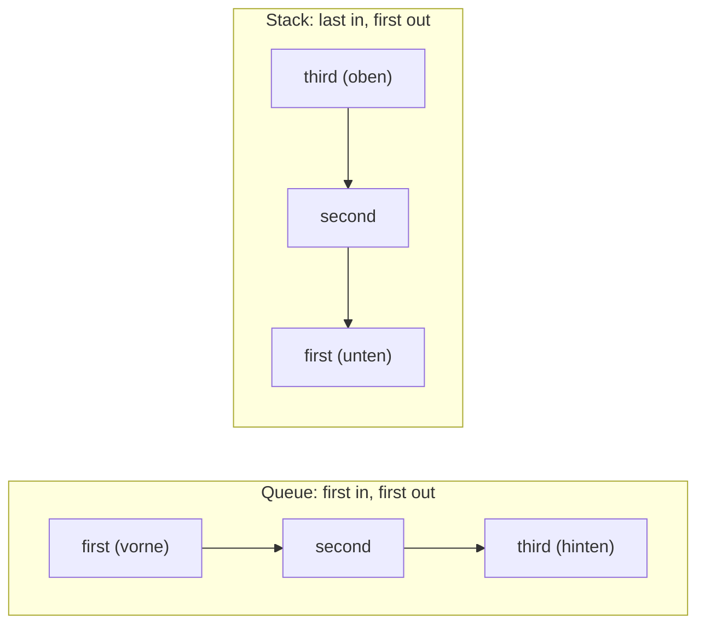

import queueBasics from '!!raw-loader!@site/examples/m05/l09/queue-basics.cs';
import queueBasicsOutput from '!!raw-loader!@site/examples/m05/l09/queue-basics.out.txt';
import stackBasics from '!!raw-loader!@site/examples/m05/l09/stack-basics.cs';
import stackBasicsOutput from '!!raw-loader!@site/examples/m05/l09/stack-basics.out.txt';
import readOnlyParameter from '!!raw-loader!@site/examples/m05/l09/read-only-parameter.cs';
import arrivalOrderGap from '!!raw-loader!@site/examples/m05/l09/arrival-order-gap.cs';
import projectTask from '!!raw-loader!@site/examples/m05/l09/seclog-collections-task.cs';
import projectInput from '!!raw-loader!@site/examples/m05/l09/seclog-collections-solution.in.txt';
import projectTests from '!!raw-loader!@site/examples/m05/l09/seclog-collections-task.tests.snippet.cs';
import projectSolution from '!!raw-loader!@site/examples/m05/l09/seclog-collections-solution.cs';

# Welche Sammlung wann?

:::note[Lernziele]
- Du kannst `Queue<T>` und `Stack<T>` benutzen und vorhersagen, welches Element `Dequeue` bzw. `Pop` liefert.
- Du kannst für eine Aufgabe begründet zwischen Array, Liste, Dictionary, HashSet, Queue und Stack wählen.
- Du kannst erklären, warum `Contains` bei einer Liste mit der Zahl der Elemente langsamer wird, bei einem HashSet im Mittel nicht.
- Du kannst eine Sammlungs-Schnittstelle wie `IReadOnlyList<string>` als Parametertyp verwenden.
:::

## Rückblick

<Quiz id="m05-l04-q4" />

<Quiz id="m05-l06-q6" />

<Quiz id="m05-l07-q3" />

## Erster rein, erster raus: Queue

Eine <Term id="queue">Queue</Term> (Warteschlange) gibt ihre Elemente in der Reihenfolge zurück, in der sie hineinkamen: first in, first out. `Enqueue(x)` hängt `x` hinten an. `Dequeue()` nimmt das vorderste Element heraus und liefert es. `Peek()` liefert das vorderste Element, ohne es zu entfernen. `Count` ist die Anzahl der Elemente.

:::info[Vorhersage]
Was gibt das Programm aus?
:::

<CSharpRunner id="m05-l09-queue" code={queueBasics} predict expected={queueBasicsOutput} />

Lösung und Erklärung anzeigen

Die Ausgabe ist `first`, `second`, `2`.

1. **Anhängen:** Drei `Enqueue`-Aufrufe: `first` steht vorne, `third` hinten.
2. **Herausnehmen:** `Dequeue()` liefert `first` und entfernt es.
3. **Ansehen:** `Peek()` liefert jetzt `second`, ohne es zu entfernen. `Count` ist 2.

## Letzter rein, erster raus: Stack

Ein <Term id="stack-collection">Stack</Term> (Stapel) arbeitet umgekehrt: last in, first out. `Push(x)` legt `x` oben auf. `Pop()` nimmt das oberste Element herunter und liefert es. `Peek()` liefert das oberste, ohne es zu entfernen. Der Stack als Sammlung ist nicht der Stack-Speicher, in dem Methodenaufrufe ihre Variablen haben.

:::info[Vorhersage]
Die Zeilen sind dieselben wie bei der Queue, nur `Push` und `Pop` stehen statt `Enqueue` und `Dequeue`. Was gibt das Programm aus?
:::

<CSharpRunner id="m05-l09-stack" code={stackBasics} predict expected={stackBasicsOutput} />

Lösung und Erklärung anzeigen

Die Ausgabe ist `third`, `second`, `2`.

1. **Aufstapeln:** Nach drei `Push`-Aufrufen liegt `third` oben.
2. **Herunternehmen:** `Pop()` liefert `third`.
3. **Ansehen:** `Peek()` liefert `second`. `Count` ist 2.

<Diagram
  caption="Queue und Stack"
  description="Links eine Queue mit den Elementen first, second, third von vorne nach hinten: Dequeue nimmt first vorne heraus, Enqueue hängt hinten an. Rechts ein Stack mit third oben, darunter second und first: Pop nimmt third oben herunter, Push legt oben auf."
>

</Diagram>

## Sammlungs-Schnittstellen als Typ

`List<string>` und `string[]` sind verschiedene Typen. Eine Methode, die nur lesen will, soll beide annehmen. Dafür gibt es <Term id="collection-interface">Sammlungs-Schnittstellen</Term> (Collection Interfaces). Eine Schnittstelle beschreibt, was man mit einem Wert tun kann, ohne zu sagen, welcher konkrete Typ es ist. Als Typ einer Variable oder eines Parameters nimmt sie jeden Wert an, der diese Fähigkeiten hat. Selbst eine Schnittstelle zu schreiben kommt erst später.

<Forward concepts={['Schnittstellen (Interfaces) selbst schreiben']} module="8" />

Die wichtigsten, von klein nach groß:

| Schnittstelle | Kann |
| --- | --- |
| `IEnumerable<T>` | mit `foreach` durchlaufen |
| `IReadOnlyCollection<T>` | durchlaufen und `Count` lesen |
| `IReadOnlyList<T>` | zusätzlich Zugriff mit `[i]`; kein `Add`, kein `Remove` |
| `ICollection<T>` | durchlaufen, `Count`, `Add`, `Remove`, `Contains` |
| `IList<T>` | zusätzlich Zugriff mit `[i]` und `Insert` |
| `IReadOnlyDictionary<TKey,TValue>` | Einträge lesen, kein Hinzufügen |
| `IDictionary<TKey,TValue>` | Einträge lesen und ändern |

Die Faustregel: Verlange als Parametertyp nur, was die Methode braucht. Eine Methode, die Elemente nur liest, nimmt `IReadOnlyList<string>`. Sie ist dann nicht an `List<string>` gebunden und kann die Liste nicht versehentlich um Elemente erweitern. Ein eindimensionales Array und eine `List<T>` erfüllen beide `IReadOnlyList<T>`.

<CSharpRunner id="m05-l09-interface" code={readOnlyParameter} />

Die Ausgabe ist `2`, `bob`, `alice`, `1`, `carol`: Dieselbe Methode `PrintAll` nimmt das Array und die Liste. Die Collection-Ausdrücke aus der letzten Lektion passen auch zu diesen Schnittstellen als Zieltyp.

## Welche Sammlung wann?

Wähle nach der Art, wie du die Sammlung benutzt:

| Ich brauche … | Sammlung |
| --- | --- |
| feste Anzahl, Zugriff über die Position | Array |
| Reihenfolge und Index, die Anzahl ändert sich | `List<T>` |
| einen Wert über einen Schlüssel finden | `Dictionary<TKey,TValue>` |
| jeden Wert nur einmal, Frage „ist er drin?“ | `HashSet<T>` |
| zuerst Eingetroffenes zuerst bearbeiten | `Queue<T>` |
| zuletzt Abgelegtes zuerst zurücknehmen | `Stack<T>` |

### Was kostet eine Suche?

`Contains` bei einer Liste prüft Element für Element. Das ist eine lineare Suche: Mit doppelt so vielen Elementen dauert sie im ungünstigen Fall doppelt so lange. Die Dokumentation nennt das eine O(n)-Operation ([List&lt;T&gt;.Contains](https://learn.microsoft.com/dotnet/api/system.collections.generic.list-1.contains#remarks)).

Ein `HashSet<T>` findet ein Element über dessen Hashcode. `Contains` ist eine O(1)-Operation, die Dauer ist konstant und hängt im Mittel nicht von der Zahl der Elemente ab. Beim Dictionary nähert sich das Suchen eines Schlüssels mit `TryGetValue` ebenfalls O(1). „Konstant“ heißt nicht „sofort“, sondern „wächst nicht mit der Elementzahl“.

Bei wenigen Elementen merkst du keinen Unterschied. Bei vielen Fragen „ist das drin?“ lohnt sich eine Menge oder ein Dictionary statt einer Liste.

:::warning[Achtung]
<Misconception id="m05-l09-contains-same-cost" />

**„`Contains` kostet bei einer Liste und bei einer Menge dasselbe.“** Das stimmt nicht. Eine Liste prüft Element für Element (linear). Eine Menge findet den Wert über seinen Hashcode, im Mittel in konstanter Zeit.
:::

## Lückenbeispiel

Die Wartenden sollen in der Reihenfolge ihres Eintreffens aufgerufen werden: `alice`, `bob`, `carol`. Das Programm gibt sie umgekehrt aus. Ändere die Sammlung und die beiden Methodenaufrufe.

<CSharpRunner id="m05-l09-gaps" code={arrivalOrderGap} />

Lösung anzeigen

1. **Fehler finden:** Ein `Stack` gibt das zuletzt Abgelegte zuerst zurück, also `carol`.
2. **Sammlung wechseln:** Wähle `Queue<string>`, `Enqueue` statt `Push` und `Dequeue` statt `Pop`. Dann kommt `alice` zuerst.

## Projektschritt

**Stand bisher:** SecLog hat die Liste `bobLines` mit den 5 fehlgeschlagenen Zeilen von `bob` und eine Beobachtungsliste.

Im Runner siehst du nur die Teile, die du für diese Anforderung brauchst: den Block *Build a watch list with collection expressions* und die Stelle am Ende der lokalen Methoden, vor der Klasse `Report`. Der übrige Code ist ausgeblendet (Zeilen mit ⋯) und läuft beim Ausführen mit. Lass die Zeilen mit ⋯ stehen.

**Neue Anforderung:** Schreibe nach der letzten lokalen Methode (vor der Klasse `Report`) die Methode `void PrintAlerts(IReadOnlyList<string> lines)`. Sie legt jede Zeile in eine `Queue<string>`. Danach nimmt sie die Zeilen in einer `while (queue.Count > 0)`-Schleife mit `Dequeue` heraus und gibt `Alert: ` mit dem Zeitstempel der Zeile aus: `line[..20]` (Bereich aus der Lektion über Indizes vom Ende). Schreibe nach dem Block *Build a watch list with collection expressions* den Block `// Print one alert per failed login of bob, in order`, der `PrintAlerts(bobLines);` aufruft. `bobLines` hat 5 Zeilen, von 08:01:40 bis 08:06:48.

<CSharpRunner id="m05-l09-project" code={projectTask} stdin={projectInput} tests={projectTests} />

Musterlösung anzeigen

<FoldedCode code={projectSolution} title="seclog-collections-solution.cs" />

1. **Parametertyp:** `IReadOnlyList<string>` nimmt die `List<string>` `bobLines` an. Die Methode liest die Zeilen nur und braucht nichts anderes.
2. **Einreihen:** Jede Zeile kommt mit `Enqueue` in die Queue.
3. **Abarbeiten:** `Dequeue` liefert die Zeilen in der Reihenfolge, in der sie eingereiht wurden. Darum erscheinen die Alarme in der Reihenfolge des Logs. Der Zeitstempel sind die ersten 20 Zeichen.

**Neuer Stand:** SecLog gibt für jeden Fehlversuch von `bob` einen Alarm aus, in der Reihenfolge des Logs.

## Weitere Themen

Für besonders schnellen Code gibt es `Span<T>` und `ref struct`. Beide sind in diesem Modul nur dem Namen nach erwähnt und werden nicht behandelt.

## Zusammenfassung

Eine `Queue<T>` gibt Elemente in der Reihenfolge des Einfügens zurück (`Enqueue`, `Dequeue`), ein `Stack<T>` in umgekehrter (`Push`, `Pop`). Als Parametertyp verlangst du nur, was du brauchst, zum Beispiel `IReadOnlyList<T>`. Array und Liste passen beide. Wähle nach der Benutzung: Index und Reihenfolge, Schlüssel, Mitgliedschaft, Warteschlange oder Stapel. `Contains` ist bei einer Liste linear, bei einer Menge im Mittel konstant.

## Prüfe dein Wissen

<Quiz id="m05-l09-q1" />

<Quiz id="m05-l09-q2" />

<Quiz id="m05-l09-q3" />

<Quiz id="m05-l09-q4" />

### In eigenen Worten erklären

<Quiz id="m05-l09-q5" />

### Transferfrage

<Quiz id="m05-l09-q6" />

## Weiterlesen

- Microsoft Learn: [Collections](https://learn.microsoft.com/dotnet/standard/collections/)
- Microsoft Learn: [Selecting a collection class](https://learn.microsoft.com/dotnet/standard/collections/selecting-a-collection-class)
