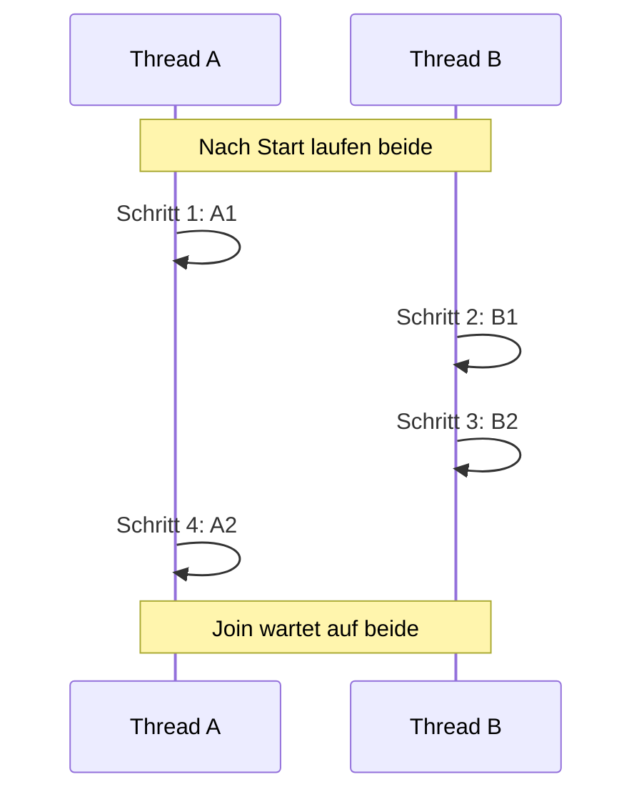

import twoThreads from '!!raw-loader!@site/examples/m13/l09/two-threads.compile.cs';
import threadJoin from '!!raw-loader!@site/examples/m13/l09/thread-join.cs';
import CodeBlock from '@theme/CodeBlock';

# Nebenläufigkeit, Parallelität, Asynchronität

:::note[Lernziele]
- Du kannst Nebenläufigkeit, Parallelität und Asynchronität mit eigenen Worten unterscheiden.
- Du kannst Prozess, Thread und Prozessorkern unterscheiden.
- Du kannst an einer Verschränkungstabelle zeigen, dass die Reihenfolge der Schritte zweier Threads nicht festgelegt ist.
- Du kannst erklären, warum die Beispiele ab hier nicht im Browser laufen.
:::

## Rückblick

<Quiz id="m13-l01-q1" />

<Quiz id="m13-l02-q2" />

<Quiz id="m13-l08-q3" />

## Drei Ideen, drei Küchenbilder

In den Lektionen davor ging es um Warten: Ein `await` gibt die Kontrolle zurück, während die Arbeit noch läuft. Ab hier geht es um mehrere Dinge gleichzeitig. Die drei Wörter dafür klingen ähnlich und meinen Verschiedenes. Ein Bild aus der Küche trennt sie:

- **Ein Koch, drei Töpfe.** Er rührt abwechselnd in jedem Topf. Alle drei Gerichte sind in Arbeit, aber in jedem Moment bewegt sich nur ein Löffel. Das ist <Term id="concurrency">Nebenläufigkeit</Term> (Concurrency): mehrere Aufgaben sind begonnen und noch nicht fertig.
- **Drei Köche, drei Töpfe.** Jeder rührt in seinem Topf, im selben Moment. Das ist <Term id="parallelism">Parallelität</Term> (Parallelism): Arbeit läuft wirklich gleichzeitig.
- **Warten auf den Ofen.** Der Koch stellt den Kuchen in den Ofen und steht nicht davor, sondern schneidet Gemüse. Das ist <Term id="asynchronous-programming">Asynchronität</Term>: Er blockiert beim Warten nicht.

Nebenläufigkeit ist der weitere Begriff. Parallelität ist ein Sonderfall davon: Es gibt mehrere Köche. Asynchronität ist eine andere Frage, nämlich was ein Programm tut, solange es wartet. In Teil A hast du das gesehen: Der Playground hat nur einen Thread, und die `async`-Beispiele laufen trotzdem.

<Quiz id="m13-l09-q1" />

## Prozess, Thread und Kern

Hinter den Köchen stecken drei technische Begriffe ([Threads and threading](https://learn.microsoft.com/dotnet/standard/threading/threads-and-threading)):

- Ein <Term id="process">Prozess</Term> ist ein laufendes Programm. Das Betriebssystem trennt Prozesse voneinander.
- Ein <Term id="thread">Thread</Term> (Ausführungsstrang) ist die Einheit, der das Betriebssystem Prozessorzeit zuteilt. Er arbeitet Anweisungen nacheinander ab. In einem Prozess können mehrere Threads laufen, und sie teilen sich den Speicher des Prozesses. Ein .NET-Programm startet mit einem Thread, dem Hauptthread.
- Ein <Term id="processor-core">Prozessorkern</Term> ist die Hardware, die Anweisungen ausführt. Mit mehreren Kernen können mehrere Threads im selben Moment laufen.

Es gibt meist mehr Threads als Kerne. Der <Term id="scheduler">Scheduler</Term> des Betriebssystems teilt die Rechenzeit auf: Er lässt einen Thread laufen, unterbricht ihn und gibt einem anderen Thread die Zeit. So entsteht Nebenläufigkeit auch auf einem einzigen Kern. Der Scheduler darf einen Thread auch mitten in einer Zeile Code unterbrechen. Wann er das tut, kann das Programm nicht vorhersagen.

<Quiz id="m13-l09-q5" />

## Die Reihenfolge ist nicht festgelegt

Zwei Threads geben je zwei Zeilen aus. Ein Thread wird mit `Start` gestartet. `Join` wartet, bis er fertig ist.

<Forward concepts={['Thread starten', '`Start` und `Join`']} lesson="m13-l10" />

<CodeBlock language="csharp" title="two-threads.cs">{twoThreads}</CodeBlock>

Nach `Start` laufen beide Threads. Der Scheduler entscheidet, welcher wann dran ist. Für jeden Thread bleibt seine eigene Reihenfolge erhalten: `A1` kommt vor `A2`, `B1` vor `B2`. Zwischen den Threads ist nichts festgelegt. Die C#-Spezifikation schützt die Wirkungen jedes Threads an bestimmten Punkten der Ausführung. Eine Reihenfolge zwischen Threads sichert sie nicht zu ([§7.9 Execution order](https://learn.microsoft.com/dotnet/csharp/language-reference/language-specification/basic-concepts#79-execution-order)).

Das Modell hier ist vereinfacht: Jeder `WriteLine`-Aufruf zählt als ein Schritt. Eine <Term id="interleaving">Verschränkungstabelle</Term> (Interleaving) zeigt einen möglichen Ablauf Schritt für Schritt. Jede Zeile ist ein Schritt, in dem genau ein Thread arbeitet:

| Schritt | Thread A | Thread B | Ausgabe bisher |
| --- | --- | --- | --- |
| 1 | `A1` | | A1 |
| 2 | | `B1` | A1, B1 |
| 3 | | `B2` | A1, B1, B2 |
| 4 | `A2` | | A1, B1, B2, A2 |

Ein anderer Lauf kann Schritt 2 und 3 mit Schritt 1 vertauschen und so eine andere Ausgabe erzeugen. Das Diagramm zeigt denselben Ablauf als Sequenz:

<Diagram
  caption="Ein möglicher Ablauf zweier Threads"
  description="Zwei Threads, A und B, laufen von oben nach unten. Zuerst gibt A die Zeile A1 aus, dann B die Zeile B1, dann B die Zeile B2 und zuletzt A die Zeile A2. Der Hauptthread wartet am Ende mit Join auf beide. Die Reihenfolge zwischen A und B ist nur ein möglicher Ablauf."
>

</Diagram>

:::info[Vorhersage]
Thread A gibt nacheinander `A1` und `A2` aus, Thread B nacheinander `B1` und `B2`. Welche Ausgaben sind möglich? Schreibe alle auf, bevor du die Frage beantwortest.
:::

<Quiz id="m13-l09-q3" />

Lösung und Erklärung anzeigen

1. **Reihenfolge innerhalb eines Threads:** `A1` vor `A2` und `B1` vor `B2` gilt in jeder möglichen Ausgabe.
2. **Mischungen aufzählen:** Wähle, an welchen zwei der vier Plätze `A1` und `A2` stehen. Es gibt 6 Möglichkeiten.
3. **Die Liste:** Mögliche Ausgaben (von Hand nachvollzogen, nicht von CI erzeugt):
   - `A1, A2, B1, B2`
   - `A1, B1, A2, B2`
   - `A1, B1, B2, A2`
   - `B1, A1, A2, B2`
   - `B1, A1, B2, A2`
   - `B1, B2, A1, A2`
4. **Was ein Lauf zeigt:** Ein einzelner Lauf zeigt nur eine der sechs. Dass sie einmal gleich aussah, beweist nicht, dass die Reihenfolge festliegt.

Sicher ist die Reihenfolge nur dort, wo ein Thread auf einen anderen wartet. Hier ist `Join` so ein Punkt: Nach `Join` ist der Thread fertig.

:::info[Vorhersage]
Ein Thread rechnet `1 + 2` und speichert das Ergebnis. Das Hauptprogramm gibt es aus. Welche Ausgabe ist sicher, und warum?
:::

<CodeBlock language="csharp" title="thread-join.cs">{threadJoin}</CodeBlock>

Die Ausgabe ist immer `Result: 3`. Das Hauptprogramm gibt erst nach `Join` aus, und dann ist der Thread fertig. Ohne `Join` könnte die Ausgabe `Result: 0` sein.

<Quiz id="m13-l09-q4" />

## Warum die Beispiele hier nicht laufen

Der Browser-Playground hat nur einen Thread. Die Ausgabe von Beispielen mit mehreren Threads, deren Reihenfolge wechselt, lässt sich dort nicht zeigen. Deshalb sind die Beispiele ab hier Code zum Lesen. Ein Ergebnis, das von der Reihenfolge abhängt, steht nur als von Hand nachvollzogene Liste da und ist so beschriftet. Beispiele, deren Ausgabe immer gleich ist, hat die automatische Prüfung des Kurses mit echten Threads ausgeführt.

<Quiz id="m13-l09-q6" />

## Projektschritt

In dieser Lektion kommt kein Projektschritt dazu, weil sie Begriffe ordnet und kein Verhalten von SecLog ändert. Ab der nächsten Lektion bekommt SecLog parallele Arbeit.

## Achtung

:::warning[Achtung]
<Misconception id="m13-l09-async-is-multithreading" />

**„`async`-Code und Multithreading sind dasselbe.“** Das stimmt nicht. Asynchroner Code gibt beim Warten die Kontrolle ab und kann mit einem Thread auskommen: Der Playground in Teil A beweist es. Multithreaded Code lässt mehrere Threads arbeiten und braucht dafür weder `async` noch `await`. Die beiden lösen verschiedene Probleme: Warten und gleichzeitiges Rechnen.
:::

<Quiz id="m13-l09-q2" />

Vertiefung: Wie Menschen über Nebenläufigkeit denken (optional)

Lernende bringen schon Vorstellungen von Nebenläufigkeit mit, bevor sie sie lernen, oft aus dem Alltag. Dazu gibt es Untersuchungen, zum Beispiel mit Schülerinnen und Schülern ([Kolikant 2001](https://doi.org/10.1076/csed.11.3.221.3831)). Die Küchenbilder dieser Lektion knüpfen an solche Alltagsvorstellungen an, und die Verschränkungstabelle prüft sie: Wer Abläufe von Hand aufschreibt, muss jeden Schritt einem Thread zuordnen.

## Zusammenfassung

Nebenläufigkeit heißt, dass mehrere Aufgaben begonnen und noch nicht fertig sind. Parallelität heißt, dass Arbeit im selben Moment auf mehreren Prozessorkernen läuft. Asynchronität heißt, beim Warten nicht zu blockieren, und geht mit einem Thread. Ein Prozess ist ein laufendes Programm, ein Thread die Einheit, der das Betriebssystem Prozessorzeit gibt, und der Scheduler entscheidet, welcher Thread wann läuft. Zwischen zwei Threads ist die Reihenfolge der Schritte nicht festgelegt, nur innerhalb eines Threads bleibt sie erhalten.

## Prüfe dein Wissen

### In eigenen Worten erklären

<Quiz id="m13-l09-q7" />

### Transferfrage

<Quiz id="m13-l09-q8" />

## Weiterlesen

- Microsoft Learn: [Threads and threading](https://learn.microsoft.com/dotnet/standard/threading/threads-and-threading)
- Microsoft Learn: [Managed threading best practices](https://learn.microsoft.com/dotnet/standard/threading/managed-threading-best-practices)
- C#-Spezifikation: [Basic concepts, Execution order](https://learn.microsoft.com/dotnet/csharp/language-reference/language-specification/basic-concepts#79-execution-order)
