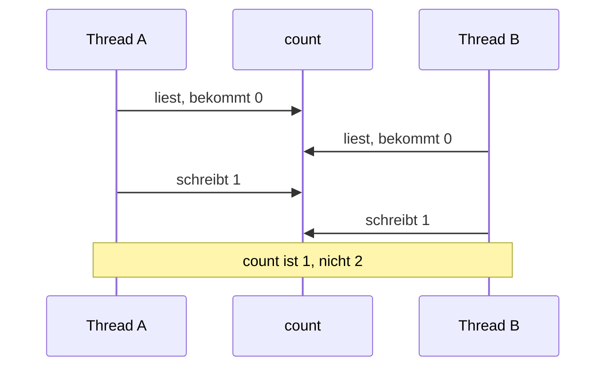

import racyCounter from '!!raw-loader!@site/examples/m13/l11/racy-counter.compile.cs';
import checkThenAct from '!!raw-loader!@site/examples/m13/l11/check-then-act.compile.cs';
import repeatTest from '!!raw-loader!@site/examples/m13/l11/repeat-test.compile.cs';
import CodeBlock from '@theme/CodeBlock';

# Race Conditions

:::note[Lernziele]
- Du kannst an einer Verschränkungstabelle zeigen, wie bei `count++` in zwei Threads ein Update verloren geht.
- Du kannst erklären, warum `count++` aus drei Schritten besteht.
- Du kannst eine Check-then-act-Race-Condition in Code finden.
- Du kannst erklären, warum ein Test, der 100-mal grün war, keine Race Condition ausschließt.
:::

## Rückblick

<Quiz id="m13-l09-q1" />

<Quiz id="m13-l10-q2" />

<Quiz id="m05-l06-q2" />

## Zwei Threads, ein Zähler

In Lektion 10 hast du gesehen, dass `Task.Run` Arbeit auf den Thread-Pool legt. Zwei Aufträge laufen dort wirklich gleichzeitig, wenn der Pool zwei Threads hat. Solange jeder Auftrag nur seine eigenen Daten benutzt, ist das harmlos. Jetzt benutzen beide dieselben Daten: Zwei Tasks addieren je 1000 Mal 1 auf einen gemeinsamen Zähler. Erwartet wird 2000.

<CodeBlock language="csharp" title="racy-counter.cs">{racyCounter}</CodeBlock>

Dieses Programm gibt nicht in jedem Lauf `Count: 2000` aus. Deshalb steht hier keine Ausgabe, und die CI führt es nicht aus, sondern übersetzt es nur. Ein Ergebnis unter 2000 bedeutet, dass Updates verloren gegangen sind. Der Rest der Lektion erklärt, wie das geschieht.

## Gemeinsame veränderbare Daten

Das Problem braucht zwei Zutaten. Erstens <Term id="shared-state">gemeinsam genutzte veränderbare Daten</Term> (Shared mutable state): mehrere Threads greifen auf dieselbe Variable zu, und mindestens einer ändert sie. Zweitens eine Reihenfolge der Schritte, die nicht festliegt (Lektion 9). Wenn alle Threads nur lesen, kann nichts schiefgehen. Wenn jeder Thread eigene Daten hat, auch nicht.

Eine <Term id="race-condition">Race Condition</Term> (Wettlaufsituation) ist ein Fehler, bei dem das Ergebnis davon abhängt, welcher Thread zuerst an einer Stelle ankommt. Zwei Läufe desselben Programms können verschiedene Ergebnisse liefern, und das Ergebnis eines Laufs lässt sich nicht vorhersagen ([Managed threading best practices](https://learn.microsoft.com/dotnet/standard/threading/managed-threading-best-practices)). Dieses Verhalten heißt <Term id="non-determinism">Nichtdeterminismus</Term>.

## count++ besteht aus drei Schritten

Das Hochzählen sieht nach einem Schritt aus. Die C#-Spezifikation beschreibt es anders: Der Wert der Variablen wird gespeichert, der Operator berechnet damit einen neuen Wert, und dieser wird in die Variable zurückgeschrieben ([§12.8.16 Postfix increment and decrement operators](https://learn.microsoft.com/dotnet/csharp/language-reference/language-specification/expressions#12816-postfix-increment-and-decrement-operators)). Die Spezifikation sagt nicht, dass diese Schritte unteilbar sind. Ein solcher Ablauf heißt <Term id="read-modify-write">Read-modify-write</Term>:

1. **Lesen:** Der Thread liest den aktuellen Wert von `count` in eine eigene Zwischenablage.
2. **Ändern:** Er addiert 1 zu dem gelesenen Wert.
3. **Schreiben:** Er schreibt das Ergebnis nach `count` zurück.

Der Scheduler darf den Thread nach jedem dieser Schritte unterbrechen (Lektion 9). Dann arbeitet ein anderer Thread, bevor der erste weitermacht.

<Quiz id="m13-l11-q2" />

## Ein Update geht verloren

Eine <Term id="interleaving">Verschränkungstabelle</Term> zeigt einen möglichen Ablauf. Hier führt jeder von zwei Threads einmal `count++` aus, und `count` ist am Anfang 0. Die Spalte „Zwischenwert“ ist das, was der Thread gelesen hat:

| Schritt | Thread A | Thread B | Zwischenwert A | Zwischenwert B | `count` |
| --- | --- | --- | --- | --- | --- |
| 0 | | | | | 0 |
| 1 | liest `count` | | 0 | | 0 |
| 2 | | liest `count` | 0 | 0 | 0 |
| 3 | schreibt 0 + 1 | | 0 | 0 | 1 |
| 4 | | schreibt 0 + 1 | 0 | 0 | 1 |

Dieser Ablauf ist von Hand nachvollzogen und nicht von CI erzeugt. Beide Threads haben den Wert 0 gelesen, bevor einer geschrieben hat. Thread B überschreibt in Schritt 4 das Ergebnis von Thread A. Es wurde zweimal hochgezählt, aber `count` ist nur 1. Das ist ein <Term id="lost-update">verlorenes Update</Term> (Lost update). In einem anderen Ablauf liest Thread B erst nach Schritt 3, und `count` wird 2.

<Diagram
  caption="Ein Update geht verloren"
  description="Zwei Threads, A und B, und der gemeinsame Zähler count mit dem Wert 0. A liest 0. B liest 0. A schreibt 1 in count. B schreibt ebenfalls 1 in count. Am Ende steht count auf 1, obwohl zweimal hochgezählt wurde."
>

</Diagram>

:::info[Vorhersage]
Zwei Threads führen gleichzeitig je einmal `count++` aus, `count` ist 0. Welche Endwerte sind möglich? Verfolge die Schritte lesen, addieren, schreiben für beide Threads.
:::

<Quiz id="m13-l11-q1" />

Lösung und Erklärung anzeigen

1. **Ein Thread läuft vollständig vor dem anderen:** Der erste liest 0 und schreibt 1, der zweite liest 1 und schreibt 2. Endwert 2.
2. **Beide lesen, bevor einer schreibt:** Beide haben 0 gelesen und schreiben 1. Endwert 1.
3. **Andere Werte:** Jeder Thread schreibt höchstens 1 mehr als den Wert, den er gelesen hat. Der Zähler kann nicht unter 1 fallen und nicht über 2 steigen.

Mögliche Endwerte (von Hand nachvollzogen, nicht von CI erzeugt): 1 und 2.

Bei 1000 Wiederholungen pro Thread passiert das viele Male. Der Endwert ist höchstens 2000. Jedes verlorene Update zieht ihn weiter nach unten, und wie viele verloren gehen, ändert sich von Lauf zu Lauf.

<Quiz id="m13-l11-q3" />

## Prüfen, dann handeln

Auch ohne `++` gibt es das Problem. Zwei Tasks tragen denselben Schlüssel in ein `Dictionary` ein, aber nur, wenn er noch fehlt:

<CodeBlock language="csharp" title="check-then-act.cs">{checkThenAct}</CodeBlock>

Das ist ein <Term id="check-then-act">Check-then-act</Term>-Fehler: Der Code prüft eine Bedingung und handelt danach, aber zwischen beidem kann ein anderer Thread die Bedingung ändern. Beide Tasks können `ContainsKey` mit `false` beantworten, bevor einer `Add` aufruft. Dann wirft der zweite `Add` eine `ArgumentException`, weil der Schlüssel schon da ist. Ein `Dictionary` unterstützt mehrere gleichzeitige Leser, aber nicht gleichzeitiges Lesen und Schreiben ohne eigene Absicherung ([Dictionary, Thread Safety](https://learn.microsoft.com/dotnet/api/system.collections.generic.dictionary-2#thread-safety)).

<Quiz id="m13-l11-q5" />

<Quiz id="m13-l11-q6" />

## Warum ein Test hier wenig beweist

Ein Test, der einen Fehler zeigen soll, läuft das Programm und vergleicht das Ergebnis. Bei einer Race Condition zeigt der Fehler sich nur bei manchen Abläufen. Dieser Test wiederholt den Zähler 100-mal:

<CodeBlock language="csharp" title="repeat-test.cs">{repeatTest}</CodeBlock>

Was dieses Programm ausgibt, lässt sich nicht vorhersagen: Es kann `Wrong runs: 0` ausgeben, obwohl der Fehler im Code steckt. Das passiert, wenn der Scheduler in diesen Läufen nie an der ungünstigen Stelle unterbricht. Auf einem anderen Rechner, unter Last oder mit anderen Zahlen kann derselbe Code verlorene Updates zeigen. Grüne Läufe zeigen nur, dass der ungünstige Ablauf in diesen Läufen nicht vorkam.

<Quiz id="m13-l11-q4" />

## Projektschritt

In dieser Lektion kommt kein Projektschritt dazu, weil SecLog nie eine Race Condition enthalten darf. Lektion 12 schützt gemeinsame Daten und gibt SecLog einen Zähler, den mehrere Tasks gefahrlos benutzen.

## Achtung

:::warning[Achtung]
<Misconception id="m13-l11-increment-is-atomic" />

**„`count++` ist ein einziger, unteilbarer Schritt.“** Das stimmt nicht. `count++` liest den Wert, addiert 1 und schreibt das Ergebnis zurück. Der Scheduler kann den Thread zwischen diesen Schritten unterbrechen, und dann arbeitet ein anderer Thread mit einem veralteten Wert.
:::

:::warning[Achtung]
<Misconception id="m13-l11-passing-runs-prove-no-race" />

**„Mein Programm lief 100-mal richtig, also hat es keine Race Condition.“** Das stimmt nicht. Eine Race Condition zeigt sich nur bei manchen Abläufen, und welche Abläufe vorkommen, entscheidet der Scheduler. Viele richtige Läufe beweisen nicht, dass der falsche Ablauf unmöglich ist.
:::

Vertiefung: Wo die Spezifikation schweigt (optional)

Die C#-Spezifikation beschreibt die Reihenfolge der Nebenwirkungen nur für den ausführenden Thread. Andere Threads dürfen andere Reihenfolgen beobachten ([§7.9 Execution order](https://learn.microsoft.com/dotnet/csharp/language-reference/language-specification/basic-concepts#79-execution-order)). Für `count++` heißt das: Weder §12.8.16 noch §7.9 verspricht, dass Lesen, Berechnen und Schreiben als ein Schritt für andere Threads sichtbar werden. Wer das braucht, muss es selbst herstellen (Lektion 12).

## Zusammenfassung

Eine Race Condition entsteht, wenn mehrere Threads gemeinsame veränderbare Daten benutzen und das Ergebnis von der Reihenfolge ihrer Schritte abhängt. `count++` besteht aus Lesen, Ändern und Schreiben. Unterbricht der Scheduler dazwischen, überschreibt ein Thread das Ergebnis des anderen, und ein Update geht verloren. Auch Check-then-act ist so ein Fehler: Zwischen Prüfen und Handeln ändert ein anderer Thread die Bedingung. Weil sich der Fehler nur bei manchen Abläufen zeigt, beweisen viele grüne Testläufe nicht, dass der Code richtig ist.

## Prüfe dein Wissen

### In eigenen Worten erklären

<Quiz id="m13-l11-q7" />

### Transferfrage

<Quiz id="m13-l11-q8" />

## Weiterlesen

- Microsoft Learn: [Managed threading best practices](https://learn.microsoft.com/dotnet/standard/threading/managed-threading-best-practices)
- C#-Spezifikation: [Postfix increment and decrement operators](https://learn.microsoft.com/dotnet/csharp/language-reference/language-specification/expressions#12816-postfix-increment-and-decrement-operators)
- C#-Spezifikation: [Basic concepts, Execution order](https://learn.microsoft.com/dotnet/csharp/language-reference/language-specification/basic-concepts#79-execution-order)
