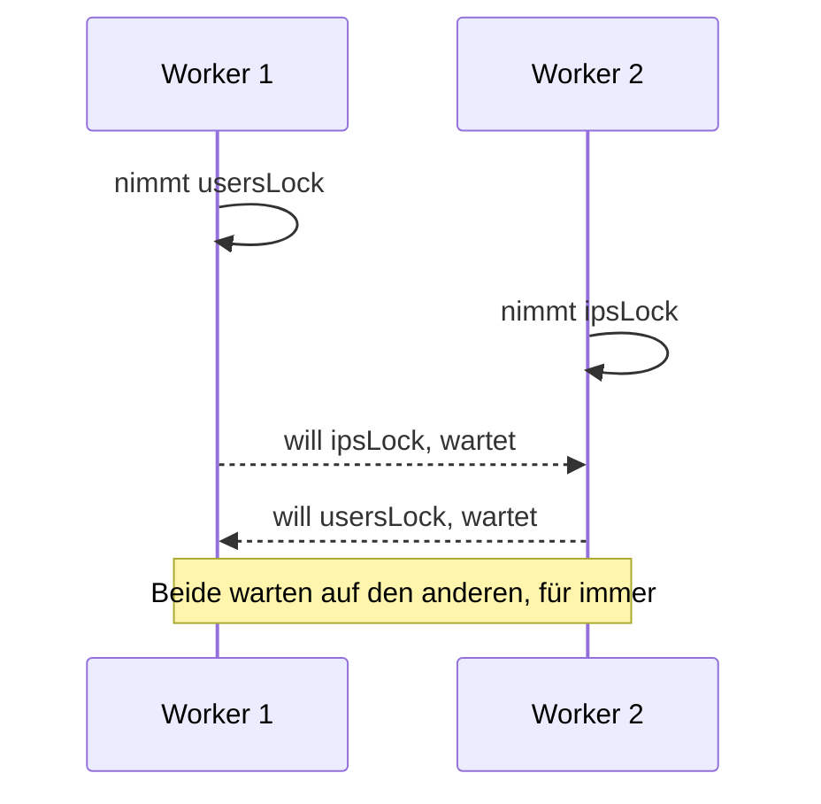

import deadlock from '!!raw-loader!@site/examples/m13/l13/deadlock.compile.cs';
import lockOrder from '!!raw-loader!@site/examples/m13/l13/lock-order.cs';
import lockOrderOutput from '!!raw-loader!@site/examples/m13/l13/lock-order.out.txt';
import tryEnter from '!!raw-loader!@site/examples/m13/l13/try-enter.cs';
import tryEnterOutput from '!!raw-loader!@site/examples/m13/l13/try-enter.out.txt';
import blockingOnTask from '!!raw-loader!@site/examples/m13/l13/blocking-on-task.snippet.cs';
import CodeBlock from '@theme/CodeBlock';

# Deadlocks und andere Gefahren

:::note[Lernziele]
- Du kannst an einem Sequenzdiagramm zeigen, wie zwei Threads mit zwei Sperren in einen Deadlock geraten.
- Du kannst einen Deadlock durch eine feste Sperr-Reihenfolge verhindern.
- Du kannst erklären, wie ein Zeitlimit (`Lock.TryEnter` mit `TimeSpan`) einen Deadlock erkennbar macht.
- Du kannst erklären, warum das Blockieren auf einen Task (Sync over Async) zu einem Deadlock führen kann.
:::

## Rückblick

<Quiz id="m13-l12-q1" />

<Quiz id="m13-l12-q5" />

<Quiz id="m13-l08-q6" />

## Zwei Sperren, zwei Worker

SecLog führt zwei Tabellen: eine für Benutzer und eine für IP-Adressen. Jede Tabelle hat ihre eigene Sperre, `usersLock` und `ipsLock`. Ein Worker, der einen Fehlschlag einträgt, sperrt zuerst die Benutzer und dann die IP-Adressen. Ein anderer Worker, der aufräumt, sperrt zuerst die IP-Adressen und dann die Benutzer. Jeder Worker ist für sich richtig. Zusammen können sie sich festfahren:

<CodeBlock language="csharp" title="deadlock.cs">{deadlock}</CodeBlock>

Für diesen Code gibt es keine echte Ausgabe, weil er hängen kann. Das Diagramm zeigt einen Ablauf, in dem er hängt:

<Diagram
  caption="Zwei Worker, zwei Sperren: ein Ablauf, der sich festfährt"
  description="Zwei Worker laufen von oben nach unten. Worker 1 nimmt die Sperre usersLock. Danach nimmt Worker 2 die Sperre ipsLock. Dann versucht Worker 1 die Sperre ipsLock zu nehmen und muss warten, weil Worker 2 sie hält. Zuletzt versucht Worker 2 die Sperre usersLock zu nehmen und muss warten, weil Worker 1 sie hält. Beide warten auf den anderen und kommen nie weiter."
>

</Diagram>

:::info[Aufgabe]
Schau dir die beiden gestrichelten Pfeile an. Wer hält welche Sperre, und worauf wartet jeder? Zeige am Diagramm den Punkt, ab dem keiner mehr weiterkommt. Die Frage danach prüft dein Ergebnis.
:::

<Quiz id="m13-l13-q1" />

Dieser Zustand heißt <Term id="deadlock">Deadlock</Term> (Verklemmung). Zwei Threads versuchen, je eine Ressource zu sperren, die der andere schon gesperrt hat, und keiner kann weitermachen ([Managed threading best practices](https://learn.microsoft.com/dotnet/standard/threading/managed-threading-best-practices)). Das Muster dahinter ist Warten im Kreis: A wartet auf B, und B wartet auf A. Dasselbe gilt für mehr als zwei Threads, solange die Kette der Wartenden zu einem Kreis geschlossen ist.

Läuft der Ablauf anders, zum Beispiel weil Worker 1 beide Sperren nimmt, bevor Worker 2 startet, geht alles gut. Der Fehler zeigt sich also nicht in jedem Lauf. Wie in Lektion 11 beweist ein grüner Lauf nichts.

## Eine feste Reihenfolge verhindert den Kreis

Der Kreis entsteht nur, weil die beiden Worker die Sperren in entgegengesetzter Reihenfolge nehmen. Nehmen alle Threads die Sperren immer in derselben Reihenfolge, kann kein Kreis entstehen. Diese Regel heißt <Term id="lock-ordering">feste Sperr-Reihenfolge</Term> (Lock ordering). Wenn ein Thread mehrere Sperren hält, müssen alle Codepfade, die zwei dieser Sperren nehmen, sie in derselben Reihenfolge nehmen. Sonst droht ein Deadlock ([System.Threading.Lock](https://learn.microsoft.com/dotnet/api/system.threading.lock)).

Ein `lock` darf in einem anderen `lock` stehen. Die innere Sperre wird zuerst frei, die äußere danach.

:::info[Vorhersage]
Beide Worker nehmen jetzt erst `usersLock`, dann `ipsLock`. Jeder zählt 1000 Mal in beiden Zählern hoch. Welche Zeile gibt das Programm aus, und kann es hängen?
:::

<CodeBlock language="csharp" title="lock-order.cs">{lockOrder}</CodeBlock>

Lösung und Erklärung anzeigen

1. **Zwei Sperren, zwei Zähler:** `usersLock` schützt `users`, `ipsLock` schützt `ips`. Beide Worker ändern beide Zähler.
2. **Feste Reihenfolge:** In `Record` steht `lock (usersLock)` immer außen und `lock (ipsLock)` immer innen. Beide Worker nutzen dieselbe Methode, also dieselbe Reihenfolge.
3. **Kein Kreis:** Wer `ipsLock` hält, hat `usersLock` schon. Wer auf `usersLock` wartet, hält noch keine Sperre. Keiner kann auf eine Sperre warten, die der andere gerade braucht, um weiterzukommen.
4. **Auf beide warten:** Erst nach `Task.WhenAll` gibt das Programm aus.

Ein echter Lauf gibt <code>{lockOrderOutput.trim()}</code> aus. Das Programm hängt nicht, und die Ausgabe ist in jedem Lauf gleich.

<Quiz id="m13-l13-q2" />

<Quiz id="m13-l13-q3" />

## Ein Zeitlimit macht den Deadlock erkennbar

Ein Deadlock wirft keine Ausnahme. Wer mit `lock` wartet, wartet ohne Grenze. Einige Methoden der Threading-Klassen haben deshalb ein Zeitlimit, das hilft, einen Deadlock zu erkennen ([Managed threading best practices](https://learn.microsoft.com/dotnet/standard/threading/managed-threading-best-practices)). Für den Typ `Lock` gibt es `TryEnter(TimeSpan)`. Die Methode versucht, die Sperre zu nehmen, und wartet höchstens so lange, wie das Zeitlimit sagt. Sie gibt `true` zurück, wenn die Sperre genommen wurde, und sonst `false` ([Lock.TryEnter](https://learn.microsoft.com/dotnet/api/system.threading.lock.tryenter)).

Wer `TryEnter` benutzt, nimmt die Sperre nicht mit `lock`. Er muss sie selbst mit `Exit` wieder freigeben, und nur, wenn `TryEnter` erfolgreich war. Das Beispiel nimmt die Sperre im Hauptthread mit `Enter`, dem Gegenstück zu `Exit`. Ein zweiter `Thread` versucht dann 50 Millisekunden lang, sie zu bekommen. `Join` wartet auf das Ende dieses Threads (Lektion 10).

:::info[Vorhersage]
Der Hauptthread hält die Sperre, bis der zweite Thread fertig ist. Welche Zeilen gibt das Programm aus?
:::

<CodeBlock language="csharp" title="try-enter.cs">{tryEnter}</CodeBlock>

Lösung und Erklärung anzeigen

1. **Sperre halten:** `gate.Enter()` nimmt die Sperre im Hauptthread. Sie bleibt belegt, bis `gate.Exit()` am Ende folgt.
2. **Mit Zeitlimit fragen:** Der zweite Thread ruft `TryEnter` mit 50 Millisekunden auf. Die Sperre wird in dieser Zeit nicht frei.
3. **Ergebnis auswerten:** `TryEnter` gibt `false` zurück. Der Thread muss `Exit` nicht aufrufen, weil er die Sperre nie hatte.

Ein echter Lauf gibt aus:

<pre><code>{tryEnterOutput.trim()}</code></pre>

<Quiz id="m13-l13-q4" />

Ein Zeitlimit löst den Deadlock nicht. Es macht ihn nur erkennbar: Der Code bekommt `false` und kann etwas tun, zum Beispiel eine Meldung ausgeben, später erneut versuchen oder aufgeben. Die Ursache, die falsche Reihenfolge, bleibt bestehen. Die ältere Klasse `Monitor` hat dafür `Monitor.TryEnter` mit demselben Zweck. Du musst sie hier nur mit Namen kennen.

## Warten auf einen Task kann ein Deadlock sein

Auch ohne zwei Sperren kann ein Deadlock entstehen. In Lektion 8 hast du das blockierende Warten auf einen Task kennengelernt: `.Result`, `.Wait()` und `GetAwaiter().GetResult()`. Der Thread tut dann nichts, bis der Task fertig ist.

Das wird gefährlich, wenn der Code in einem <Term id="synchronization-context">Synchronisationskontext</Term> läuft, der nur einen Thread zulässt, zum Beispiel in einer Anwendung mit Fenster. Der Rest einer `async`-Methode nach einem `await` will dann auf diesem einen Thread weiterlaufen. Wartet derselbe Thread blockierend auf den Task, ist er belegt. Der Task wartet auf den Thread, der Thread wartet auf den Task:

<CodeBlock language="csharp" title="blocking-on-task.cs">{blockingOnTask}</CodeBlock>

In einer Konsolenanwendung gibt es diesen Kontext nicht. Dort läuft der Rest auf einem Thread aus dem Thread-Pool weiter, und das Beispiel würde nicht hängen. Gut ist es trotzdem nicht, weil der wartende Thread belegt bleibt. Die Regel aus Lektion 8 gilt weiter: Auf einen Task wartet man mit `await`.

<Quiz id="m13-l13-q6" />

## Starvation und Livelock

Zwei weitere Gefahren kennst du hier nur mit Namen. <Term id="starvation">Starvation</Term> (Aushungern) heißt: Ein Thread kommt über lange Zeit nicht zum Zug, weil andere die Ressource immer wieder vor ihm belegen. Ein Beispiel ist der Thread-Pool: Blockieren sehr viele seiner Threads für lange Zeit, können neue Arbeitsaufträge nicht starten ([The managed thread pool](https://learn.microsoft.com/dotnet/standard/threading/the-managed-thread-pool)). Bei einem <Term id="livelock">Livelock</Term> reagieren Threads ständig aufeinander und ändern ihren Zustand, kommen aber nicht voran. Anders als beim Deadlock stehen sie nicht still.

<Quiz id="m13-l13-q7" />

## Projektschritt

In dieser Lektion kommt kein Projektschritt dazu, weil SecLog nur eine Sperre benutzt und es keine zweite Sperre gibt, deren Reihenfolge zu regeln wäre. Der nächste Schritt in Lektion 14 baut deshalb auf Lektion 12 auf.

## Achtung

:::warning[Achtung]
<Misconception id="m13-l13-deadlock-throws-exception" />

**„Bei einem Deadlock gibt das Programm eine Fehlermeldung aus oder wirft eine Ausnahme.“** Das stimmt nicht. Ein Programm im Deadlock hängt einfach: keine Ausnahme, keine Meldung. Man merkt nur, dass nichts mehr passiert. Erkennbar wird ein Deadlock nur, wenn der Code selbst ein Zeitlimit setzt, wie bei `TryEnter`.
:::

<Quiz id="m13-l13-q5" />

## Zusammenfassung

Ein Deadlock entsteht, wenn Threads im Kreis aufeinander warten, etwa weil zwei Worker zwei Sperren in entgegengesetzter Reihenfolge nehmen. Das Programm hängt dann ohne Ausnahme und ohne Meldung. Eine feste Sperr-Reihenfolge für alle Threads verhindert den Kreis. Ein Zeitlimit wie `Lock.TryEnter(TimeSpan)` löst ihn nicht, macht ihn aber erkennbar. Das blockierende Warten auf einen Task kann in einem Kontext mit nur einem Thread zu einem Deadlock führen, in einer Konsolenanwendung nicht. Starvation und Livelock sind zwei weitere Gefahren, die du mit Namen kennst.

## Prüfe dein Wissen

### In eigenen Worten erklären

<Quiz id="m13-l13-q8" />

### Transferfrage

<Quiz id="m13-l13-q9" />

## Weiterlesen

- Microsoft Learn: [Managed threading best practices](https://learn.microsoft.com/dotnet/standard/threading/managed-threading-best-practices)
- Microsoft Learn: [System.Threading.Lock](https://learn.microsoft.com/dotnet/api/system.threading.lock)
- C#-Spezifikation: [The lock statement](https://learn.microsoft.com/dotnet/csharp/language-reference/language-specification/statements#1313-the-lock-statement)
