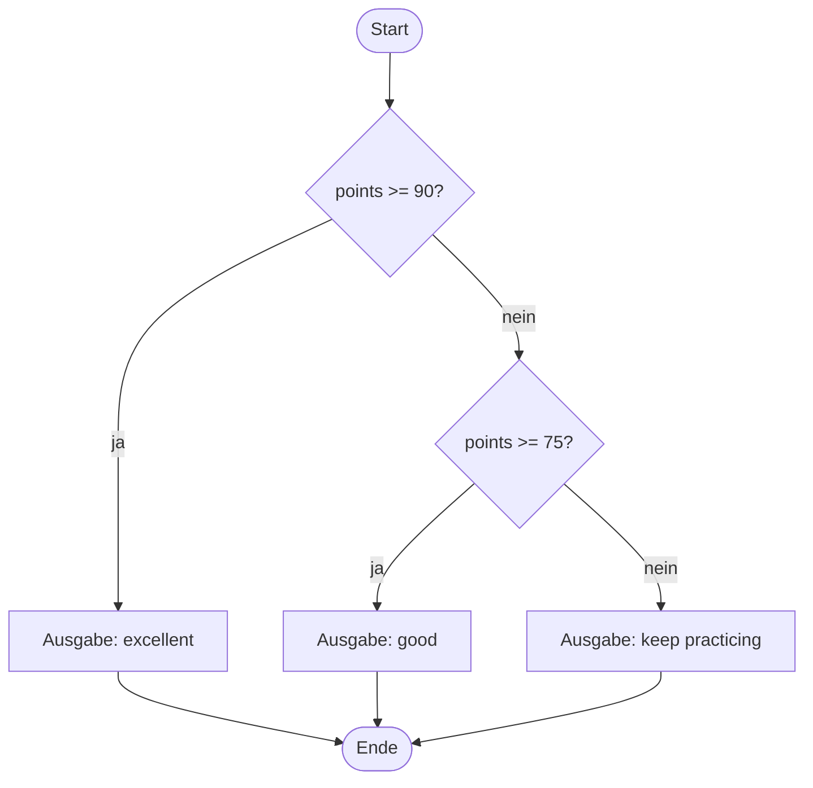
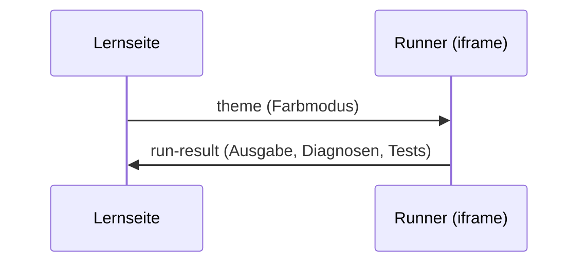

import Head from '@docusaurus/Head';

<Head>
  <meta name="robots" content="noindex" />
</Head>

<DevNav />

# Demo: Diagramme (Mermaid)

Wechsle zwischen hellem und dunklem Modus: Die Diagramme werden neu gezeichnet und der Text bleibt lesbar. Jedes Diagramm hat eine Bildunterschrift und eine Textbeschreibung.

## Ablauf von if / else if / else

<Diagram
  caption="Ablauf von if / else"
  description="Das Programm startet und prüft, ob points größer oder gleich 90 ist. Wenn ja, gibt es excellent aus. Wenn nein, prüft es, ob points größer oder gleich 75 ist. Wenn ja, gibt es good aus. Wenn nein, gibt es keep practicing aus. Danach endet das Programm."
>

</Diagram>

## Nachrichten zwischen Seite und Runner

<Diagram
  caption="Nachrichtenfluss zwischen Lernseite und Runner"
  description="Die Lernseite sendet dem Runner die Nachricht theme mit dem Farbmodus. Nach dem Ausführen sendet der Runner der Lernseite die Nachricht run-result mit Ausgabe, Diagnosen und Testergebnissen."
>

</Diagram>
